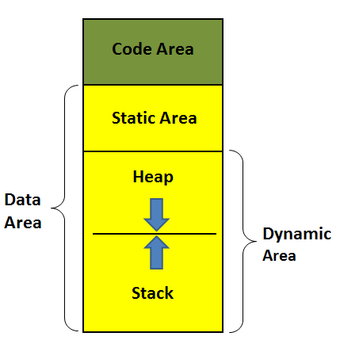

## 内存四区

计算机中的内存是分区来管理的，程序和程序之间的内存是独立的，不能互相访问，比如QQ和浏览器分别所占的内存区域是不能相互访问的。而每个程序的内存也是分区管理的，一个应用程序所占的内存可以分为很多个区域，我们需要了解的主要有四个区域，通常叫内存四区。



### 1.代码区

程序被操作系统加载到内存的时候，所有的可执行代码（程序代码指令、常量字符串等）都加载到代码区，这块内存在程序运行期间是不变的。代码区是平行的，里面装的就是一堆指令，在程序运行期间是不能改变的。函数也是代码的一部分，故函数都被放在代码区，包括main函数。

注意："int a = 0;"语句可拆分成"int a;"和"a = 0"，定义变量a的"int a;"语句并不是代码，它在程序编译时就执行了，并没有放到代码区，放到代码区的只有"a = 0"这句。

### 2.静态区

静态区存放程序中所有的全局变量和静态变量。

### 3.栈区

栈（stack）是一种先进后出的内存结构，所有的自动变量、函数形参都存储在栈中，这个动作由编译器自动完成，我们写程序时不需要考虑。栈区在程序运行期间是可以随时修改的。当一个自动变量超出其作用域时，自动从栈中弹出。

每个线程都有自己专属的栈；栈的最大尺寸固定，超出则引起栈溢出；变量离开作用域后栈上的内存会自动释放。

+ **实验一**：观察代码区、静态区、栈区的内存地址

```cpp
#include <stdio.h>
int g = 0;
void test(int a, int b)
{
	printf("形式参数a的地址是：%p\n形式参数b的地址是：%p\n", &a, &b);
}
int main()
{
	static int m = 0;
	int a = 0;
	int b = 0;
	printf("自动变量a的地址是：%p\n自动变量b的地址是：%p\n", &a, &b);
	printf("全局变量g的地址是：%p\n静态变量m的地址是：%p\n", &g, &m);
	test(a, b);
	printf("main函数的地址是：%p", &main);
	return 0;
}
```

**结果分析：**自动变量a和b依次被定义和赋值，都在栈区存放，内存地址只相差12，需要注意的是a的地址比b要大，这是因为栈是一种先进后出的数据存储结构，先存放的a,后存放的b,形象化表示如上图（注意地址编号顺序）。一旦超出作用域，那么变量b将先于变量a被销毁。这很像往箱子里放衣服，最先放的最后才能被拿出，最后放的最先被拿出。

另外，栈不会很大，一般都是以K为单位。如果在程序中直接将较大的数组保存在函数内的栈变量中，很可能会内存溢出，导致程序崩溃，严格来说应该叫栈溢出（当栈空间以满，但还往栈内存压变量，这个就叫栈溢出）。

如果你需要大量的空间来存储，则需要堆出场了！

### 4.堆区

堆（heap）和栈一样，也是一种在程序运行过程中可以随时修改的内存区域，但没有栈那样先进后出的顺序。更重要的是堆是一个大容器，它的容量要远远大于栈。一般比较复杂的数据类型都是放在堆中。但是在C语言中，堆内存空间的申请和释放需要手动通过代码来完成。对于一个32位操作系统，最大管理管理4G内存，其中1G是给操作系统自己用的，剩下的3G都是给用户程序，而在一个程序中，一个用户动态分配理论上可以使用3G的内存空间。堆上的内存必须手动释放（C/C++），除非语言执行环境支持GC（如C#在.NET上运行就有垃圾回收机制）。那堆内存如何使用？


## 动态内存分配

动态内存是相对静态内存而言的。所谓动态和静态就是指内存的分配方式。动态内存是指在堆上分配的内存，而静态内存是指在栈上分配的内存。

前面所写的程序大多数都是在栈上分配的，比如局部变量、形参、函数调用等。栈上分配的内存是由系统分配和释放的，空间有限，在复合语句或函数运行结束后就会被系统自动释放。而堆上分配的内存是由程序员通过编程自己手动分配和释放的，空间很大，存储自由。堆和栈后面还会专门讲，这里先了解一下。

**动态分配意义**

+ 定义数组时必须指定数组的大小，使用动态分配可以在运行时调整大小。
+ 突破函数内局部变量的作用域局限，函数结束之后，不希望变量的内存被释放。

### 库函数

那么动态内存是怎么造出来的？在讲如何动态地把一个数组造出来之前，我们必须要先介绍 malloc 函数的使用。

#### malloc

malloc 是一个系统函数，它是 `memory allocate` 的缩写。其中memory是“内存”的意思，allocate是“分配”的意思。顾名思义 malloc 函数的功能就是“分配内存”。要调用它必须要包含头文件<stdlib.h>。

```cpp
void* malloc(size_t _Size);
int* parr = calloc(sizeof(int) * 10);
```

malloc 函数只有一个形参，并且是整型。该函数的功能是在内存的动态存储空间即堆中分配一个长度为size的连续空间。函数的返回值是一个指向所分配内存空间起始地址的指针，类型为 void*型。

简单的理解，malloc 函数的返回值是一个地址，这个地址就是动态分配的内存空间的起始地址。如果此函数未能成功地执行，如内存空间不足，则返回空指针 NULL。

“int i=5；”表示分配了 4 字节的“静态内存”。这里需要强调的是：“静态内存”和“静态变量”虽然都有“静态”两个字，但是它们没有任何关系。不要以为“静态”变量的内存就是“静态内存”。静态变量的关键字是 static，它与全局变量一样，都是在“静态存储区”中分配的。这块内存在程序编译的时候就已经分配好了，而且在程序的整个运行期间都存在；而静态内存是在栈中分配的，比如局部变量。

#### calloc

calloc函数的功能与malloc函数的功能相似，都是从堆分配内存。最大的不同在于calloc会把申请的空间全部初始化为0。

```cpp
void* calloc(size_t _Count,size_t _Size);
int* parr = calloc(10,sizeof(int));
```

#### realloc

realloc函数的功能比malloc函数和calloc函数的功能更为丰富，可以实现内存分配和内存释放的功能。

```cpp
void* realloc(void*  _Block,size_t _Size);
int* pnew = realloc(parr,20);
```

+ _Block是堆上已经存在空间的地址
+ _Size是目标空间大小

重新分配堆上的void指针\_Block所指的空间为\_Size个字节，同时会复制原有内容到新分配的堆上存储空间。注意，若\_Size小于或等于原来空间的字节，则保持不变。否则会扩容。

#### free

前面讲过，动态分配的内存空间是由程序员手动编程释放的。那么怎么释放呢？用 free 函数。

```cpp
void free(void* _Block);
```

free 函数无返回值，它的功能是释放指针变量 p 所指向的内存单元。此时 p 所指向的那块内存单元将会被释放并还给操作系统，不再归它使用。操作系统可以重新将它分配给其他变量使用。

需要注意的是，释放并不是指清空内存空间，而是指将该内存空间标记为“可用”状态，使操作系统在分配内存时可以将它重新分配给其他变量使用。

### 注意

动态创建的内存如果不用了必须要释放。注意，一个动态内存只能释放一次。如果释放多次程序就会崩溃，因为已经释放了，不能再释放第二次。

malloc 和 free 一定要成对存在，一一对应。有 malloc 就一定要有 free，有几个 malloc 就要有几个 free，与此同时，每释放一个指向动态内存的指针变量后要立刻把它指向 NULL。

最后需要强调的是，只有动态创建的内存才能用 free 把它释放掉，静态内存是不能用free释放的。静态内存只能由系统释放。比如：

```
int a = 10;
int *p = &a;
free(p);	//error
```

如果试图用 free(p) 把指针变量 p 所指向的内存空间释放掉，那么编译的时候不会出错，但程序执行的时候立刻就出错。

## 函数与指针

### 函数指针

如果在程序中定义了一个函数，那么在运行时系统就会为这个函数代码分配一段存储空间，这段存储空间的首地址称为这个函数的地址。而且函数名表示的就是这个地址。既然是地址我们就可以定义一个指针变量来存放，这个指针变量就叫作函数指针变量，简称函数指针。

#### 函数指针定义

`函数返回值类型  (* 指针变量名) (函数参数列表);`

+ “函数返回值类型”表示该指针变量所指向函数的 返回值类型；

+ “函数参数列表”表示该指针变量所指向函数的参数列表。

**那么怎么判断一个指针变量是指向变量的指针，还是指向函数的指针变量呢？**

+ 看变量名的后面有没有带有形参类型的圆括号，如果有就是指向函数的指针变量，即函数指针，如果没有就是指向变量的指针变量。

+ 函数指针没有++和 --运算

#### 函数指针使用

定义一个实现两个数相加的函数。

```cpp
int add(int a,int b)
{
    return a+b;
}
int main()
{
    int (*pfun)(int,int) = add;
    int res = pfun(5,3);
    printf("res:%d\n",res);
    
    return 0;
}
```

在给函数指针pfun赋值时，可以直接用add赋值，也可以用&add赋值，效果是一样的。

在使用函数指针时，同样也有两种方式，1，pfun(5,3);  2，(*pfun)(5,3)

#### 案例

##### 计算器

用函数指针实现一个简单的计算器，支持+、-、*、/、%

```cpp
//plus sub multi divide mod		//加 减 乘 除 取余
```

当功能太多时，switch语句太长，因此不是一种好的编程风格。好的设计理念应该是把具体的操作和和选择操作的代码分开。

##### 函数指针作为转换表

转换表就是一个函数指针数组。

```cpp
#include<stdio.h>
#include<math.h>

// 转换表
// 转换表 step1:
//(1.1)声明 状态转移函数
double add(double, double);
double sub(double, double);
double mul(double, double);
double div(double, double);
double hypotenuse(double, double);
//(1.2)声明并初始化一个函数指针数组    pfunc:数组   数组元素:函数指针  返回值：double型数据
double(*pfunc[])(double, double) = { add, sub, mul, div, hypotenuse };//5个转移状态

//状态转移函数的实现
double add(double a, double b){	return a + b;}
double sub(double a, double b){ return a - b; }
double mul(double a, double b){ return a * b; }
double div(double a, double b){ return a / b; }
double hypotenuse(double a, double b){ return sqrt(pow(a, 2) + pow(b, 2)); }

void test()
{
	//转换表 step2:调用 函数指针数组
	int n = sizeof(pfunc) / sizeof(pfunc[0]);//转移表中 包含的元素个数（状态转移函数个数）
	for (int i = 0; i < n; ++i){
		printf("%.2lf\n",pfunc[i](3, 4));
	}
}
int main()
{
	test();
	return 0;
}
```

### typedef

**一，使用typedef为现有类型创建别名，给变量定义一个易于记忆且意义明确的新名字。**

+ 类型过长，用typedef可以简化一下

```c
typedef unsigned int UInt32
```

+ 还可以定义数组类型

```c
typedef int IntArray[10];
IntArray arr;				//相当于int arr[10]
```


**二、使用typedef简化一些比较复杂的类型声明。**

例如：

```c
typedef int (*CompareCallBack)(int,int);
```

上述声明引入了PFUN类型作为函数指针的同义字，该函数有两个类型分别为int、int、char参数，以及一个类型为int的返回值。通常，当某个函数的参数是一个回调函数时，可能会用到typedef简化声明。
例如，承接上面的示例，我们再列举下列示例：

```c
int callBackTest(int a,int b,CompareCallBack cmp);
```

callBackTest函数的参数有一个CompareCallBack类型的回调函数。在这个示例中，如果不用typedef，callBackTest函数声明如下：

```c
int callBackTest(int a,int b,int (*cmp)(int,int));
```


从上面两条函数声明可以看出，不使用typedef的情况下，callBackTest函数的声明复杂得多，不利于代码的理解，并且增加的出错风险。

所以，在某些复杂的类型声明中，使用typedef进行声明的简化是很有必要的。

### 回调函数

#### 介绍

钩子函数、回调函数、注册函数，挂钩子这些我们代码中经常涉及到的东西，是否已经困扰你很久了？它们究竟是怎么回事，究竟怎么用？下面我来为你一一解答。

什么是钩子函数？

钩子函数也叫回调函数，是通过函数指针来实现的，那我们来看看什么是函数指针。

#### 函数指针

首先要明确一点，函数也可以作为函数参数来传递的。

例如，定义函数指针：

```c
int (* g_callback) (int x, int y);
```

有两个函数：

```c
/*返回两个参数中的最大值*/
int Max(int x, int y){return x>y?x:y;}
 
/*返回两个参数中的最小值*/
int Min(int x, int y){return x<y?x:y;}
 
int main(int argc, char* argv[])
{
	int a = 10;
    int b = 15;
    
    /*我们让函数指针先后指向不同的函数*/   
    g_callback = Max;
    printf("%d\n", g_callback(a,b));	/*相当于调用函数Max*/
    
    g_callback = Min;
    printf("%d\n", g_callback(a, b)）; /*相当于执行函数Min*/
           
    return 0;
}
```

分别输出:15    10

这样，同样调用callback，两次却完成不同的功能，神奇吧？这就是函数指针的妙用。

Max，Min函数就是钩子函数了，把函数指针g_pFun指向函数Max，Min的过程，就是“挂钩子”的过程，把钩子函数“挂”到函数指针上，很形象。

#### 钩子函数作用

有人可能有疑问，那么这里为什么不直接调用Max和Min函数呢？

这是因为，我们在写main函数的时候，可能还不知道它会完成什么功能，这时候留下函数指针作为接口，可以挂上不同的函数完成不同的功能，究竟执行什么功能由钩子函数的编写者完成。

#### 钩子函数使用

那我们平时怎么用的呢？

在我们的代码中，常常把挂钩子的过程叫做注册，会提供一个注册函数，让使用者把自己编写的钩子函数挂在已经声明的函数指针上，这个注册函数的参数就是我们的函数指针了，比如，我们可以给刚才的函数指针提供一个注册函数：

```c
int RegFun( int (* pFun)(int x, int y) ) /*注册函数的参数是函数指针*/
{
    g_pFun = pFun;
    return 0;
}
```

调用RegFun(Max)和RegFun(Min),就可以把钩子函数挂上去了。

注意：为了便于使用，函数指针往往被声明为全局变量，这也是刚才把函数指针的名字命名为g_callback的原因。


下面我们来进行一下实战演习，比如，我们要实现定时器的功能，但是具体的操作还不确定，我们完成这样的代码：

```c
#include<stdio.h>
#include<time.h>
#include<stdbool.h>

#if 0
typedef void(*TimeOutCallback)();
//定时器函数
void timer(int ms, TimeOutCallback func)
{
	static int start = 0;
	if (clock() - start >=  ms)
	{	
		func();
		start = clock();
	}
}

void show()
{
	printf("%s\n", "show");
}

int main()
{

	while (true)
	{
		timer(1000,show);
	}

	return 0;
}
#else

#define TIMER_MAX_SIZE 10

typedef void(*TimeOutCallback)(int);
int startTime[TIMER_MAX_SIZE];
int timeout[TIMER_MAX_SIZE];
TimeOutCallback timerFunc[TIMER_MAX_SIZE];
int size;

//注册定时器
int registerTimer(int ms, TimeOutCallback func)
{
	startTime[size] = 0;
	timerFunc[size] = func;
	timeout[size] = ms;
	return size++;
}
//移除定时器
void removeTimer(int id)
{
	for (int i = id; i < size - 1; i++)
	{
		startTime[i] = startTime[i + 1];
		timerFunc[i] = timerFunc[i + 1];
		timeout[i] = timeout[i + 1];
	}
	startTime[size - 1] = 0;
	size--;
}

//定时器更新函数
void updateTimer()
{
	for (int i = 0; i < size; i++)
	{
		//如果第一次开始初始化一次，防止开始就调用一次
		//if (startTime[i] == 0) startTime[i] = clock();
		if (clock() - startTime[i] >= timeout[i])
		{
			timerFunc[i](i);
			startTime[i] = clock();
		}
	}
}

void show(int id)
{
	printf("%s\n", "show");
}

void show1(int id)
{
	printf("%s\n", "show1");
}

void show2(int id)
{
	printf("%s\n", "show2");
	removeTimer(id);
}

int main()
{
	registerTimer(1000, show);
	registerTimer(2000, show1);
	registerTimer(3000, show2);
	while (true)
	{
		updateTimer();
	}

	return 0;
}
#endif

```

因为应用模块无法修改平台的代码，只能调用平台提供的注册函数。

这样，平台部分无需修改任何代码，只是应用模块注册了不同的钩子函数，就能够完成不同的功能，这就是钩子函数的妙用。
