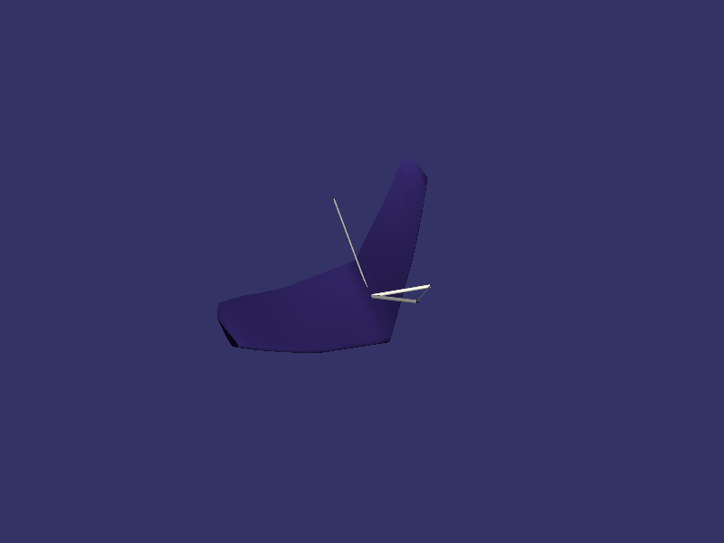
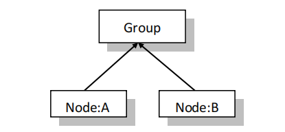
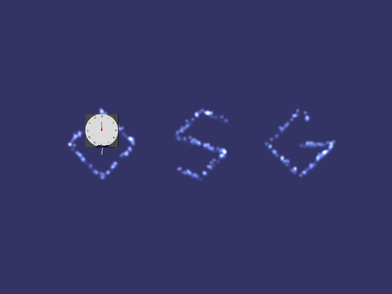
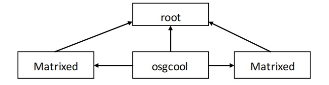

# OSG基础

## 环境配置

### CMake配置

#### 顶层CMake文件

```cmake
# CMakeList.txt: 顶层 CMake 项目文件，在此处执行全局配置
cmake_minimum_required (VERSION 3.10)

# 如果支持，请为 MSVC 编译器启用热重载。
if (POLICY CMP0141)
  cmake_policy(SET CMP0141 NEW)
  set(CMAKE_MSVC_DEBUG_INFORMATION_FORMAT "$<IF:$<AND:$<C_COMPILER_ID:MSVC>,$<CXX_COMPILER_ID:MSVC>>,$<$<CONFIG:Debug,RelWithDebInfo>:EditAndContinue>,$<$<CONFIG:Debug,RelWithDebInfo>:ProgramDatabase>>")
endif()

project ("osg_learn")

# 所有子项目共享变量
## C++标准
set(CMAKE_CXX_STANDARD 20)
set(CMAKE_CXX_STANDARD_REQUIRED ON)
## Osg根目录
set(OSG_DIR "F:/Tools/Osg/OpenSceneGraph-3.6.5-VC2022-64-2025-04")
## 资源路径
set(RESOURCE_PATH "${CMAKE_SOURCE_DIR}/OpenSceneGraph-data")
message(STATUS "=======RESOURCE_PATH: ${RESOURCE_PATH}")
## 设置库文件目录
include_directories(${OSG_DIR}/include)
## 设置库文件目录
link_directories(${OSG_DIR}/lib)
## 将${OSG_DIR}/bin目录中所有dll文件保存到变量OSG_DLLS中
file(GLOB OSG_DLLS ${OSG_DIR}/bin/*.dll)
if(CMAKE_BUILD_TYPE STREQUAL "Debug")
    file(GLOB OSG_PLUGIN_DLLS ${OSG_DIR}/bin/osgPlugins-3.6.5/osgdb_*d.dll)
else()
    file(GLOB OSG_PLUGIN_DLLS ${OSG_DIR}/bin/osgPlugins-3.6.5/osgdb_*.dll)
    list(FILTER OSG_PLUGIN_DLLS EXCLUDE REGEX ".*d\\.dll$")
endif()
message(STATUS "=======OSG_PLUGIN_DLLS: ${OSG_PLUGIN_DLLS}")
## 需要链接的OSG模块列表
set(OSG_MODULES
    OpenThreads
    osg
    osgDB
    osgGA
    osgUtil
    osgViewer
    osgQOpenGL
    osgTerrain
    osgShadow
    osgParticle
    osgManipulator
    osgAnimation
    osgText
    osgUI
    osgWidget
    osgSim
    osgFX
    osgVolume
    osgPresentation
)

# 包含子项目。
add_subdirectory ("demo_1")
```

#### 子项目CMake文件

```cmake
cmake_minimum_required(VERSION 3.12)

project(demo_1 LANGUAGES CXX)

#将需要的库拷贝到二进制目录
file(COPY ${OSG_DLLS} DESTINATION ${PROJECT_BINARY_DIR})
#file(COPY ${OSG_DIR}/bin/osgPlugins-3.6.5 DESTINATION ${PROJECT_BINARY_DIR})
file(COPY ${OSG_PLUGIN_DLLS} DESTINATION ${PROJECT_BINARY_DIR}/osgPlugins-3.6.5)

#添加宏
add_compile_definitions(OSG_RESOURCE_PATH="${RESOURCE_PATH}")

# 将源代码添加到此项目的可执行文件。
add_executable (${PROJECT_NAME} "main.cpp")

# TODO: 如有需要，请添加测试并安装目标。
# 遍历模块，自动区分Debug/Release后缀
foreach(mod ${OSG_MODULES})
    if(WIN32)
        target_link_libraries(${PROJECT_NAME} PRIVATE
            $<$<CONFIG:Debug>:${mod}d>
            $<$<CONFIG:Release>:${mod}>
        )
    else()
        target_link_libraries(${PROJECT_NAME} PRIVATE ${mod})
    endif()
endforeach()
```

如果没有分顶层和子项目，直接将添加子项目：

```cmake
# 包含子项目。
add_subdirectory ("demo_1")
```

替换为子项目CMake文件，从第5行开始到最后的所有内容即可！

## 第一个小程序

在学习各种语言的时候当中，都会有程序名为Hello World，在OSG中也不例外，在OSG中也会有了了几行的程序来说明OSG中的一些功能和机制。

```cpp
#include "osgViewer/Viewer"
#include "osgDB/ReadFile"

int main()
{
	//设置日志级别，查看加载信息
	osg::setNotifyLevel(osg::NotifySeverity::INFO);
	//创建观察器
	osgViewer::Viewer viewer;
	//设置场景数据
	viewer.setSceneData(osgDB::readNodeFile(OSG_RESOURCE_PATH"/glider.osg"));
	//让设置生效
	viewer.realize();
	//运行观察器
	return viewer.run();
}
```

默认是全屏显示的，不是很方便，我们设置一下窗口位置和大小！

```cpp
//包含新的头文件
#include "osgViewer/config/SingleWindow"
//#include "osgViewer/config/SingleScreen"
//设置窗口大小和位置(必须在viewer.realize()之前设置才生效)
viewer.apply(new osgViewer::SingleWindow(50, 50, 800, 600));
//如果有多快屏幕还可以设置显示在哪块屏幕上（参数为屏幕ID：0,1...）
//viewer.apply(new osgViewer::SingleScreen(1));
```

运行效果如下：



## 事件处理器

osgGA::GUIEventHandler 事件处理器，一句话概括：专门接收窗口产生的各类输入消息，把鼠标、键盘、滚轮、窗口变化转换成业务逻辑，是用户和三维场景交互的入口。

**可以捕获哪些事件：**

1. 键盘：按下、抬起（ESC 退出、空格漫游启停、± 调节 LODScale）
2. 鼠标：左键 / 右键按下、抬起、移动、拖拽、滚轮滚动（拾取、缩放视角）
3. 窗口事件：窗口大小改变、最小化
4. FRAME 帧事件：每一帧自动触发（持续监测按键按住状态）

```cpp
#include "osgViewer/Viewer"
#include "osgViewer/config/SingleWindow"
#include "osgViewer/config/SingleScreen"
#include "osgViewer/ViewerEventHandlers"
#include "osgDB/ReadFile"

class MyEventHandler : public osgGA::GUIEventHandler
{
public:
	using osgGA::GUIEventHandler::GUIEventHandler;

	//获取使用样例
	void getUsage(osg::ApplicationUsage& usage) const override {
		usage.addKeyboardMouseBinding("name", "maye is nice!");
		usage.addKeyboardMouseBinding("hello", "hello world!");
	}

	bool handle(const osgGA::GUIEventAdapter& ea, osgGA::GUIActionAdapter& aa) override {
		//判断事件是否已经被处理
		if (ea.getHandled()) {
			return false;
		}

		switch (ea.getEventType()) {
		case osgGA::GUIEventAdapter::KEYDOWN: {
			osg::notify(osg::INFO) << "key down" << ea.getKey() << std::endl;
			if (ea.getKey() == 'h') {
				return true;	//处理了，按h键不会打印帮助
				//return false;	//没有处理，按h键会打印帮助
			}
		}
		break;
		default:
			break;
		}
		//返回false，表示事件没有被处理，会交给下一个事件处理器
		//返回ture，表示事件已经被处理，不会交给下一个事件处理器
		return false;
	}
};

//添加事件处理器
void addEventHandler(osgViewer::Viewer* viewer)
{
	//添加自定义处理器
	//viewer->addEventHandler(new MyEventHandler);

	//帮助事件处理器(按h键显示帮助信息)
	viewer->addEventHandler(new osgViewer::HelpHandler);

	//状态处理器(按s键显示状态信息，按大S将信息显示到控制台)
	viewer->addEventHandler(new osgViewer::StatsHandler);

	//窗口大小处理器(按f切换全屏)
	viewer->addEventHandler(new osgViewer::WindowSizeHandler);

	//屏幕捕获处理齐全(按c键捕获当前窗口图片,按大C捕获每一帧(相当于视频))
	viewer->addEventHandler(new osgViewer::ScreenCaptureHandler);

	//记录帧率处理器(按z记录路径，按Z播放路径)
	viewer->addEventHandler(new osgViewer::RecordCameraPathHandler);
}

int main()
{
	//设置日志级别，查看加载信息
	osg::setNotifyLevel(osg::NotifySeverity::INFO);
	//创建观察器
	osgViewer::Viewer viewer;
	//设置场景数据
	viewer.setSceneData(osgDB::readNodeFile(OSG_RESOURCE_PATH"/glider.osg"));
	//设置窗口大小和位置
	viewer.apply(new osgViewer::SingleWindow(50, 50, 800, 600));
	//viewer.apply(new osgViewer::SingleScreen(1));

	addEventHandler(&viewer);

	//让设置生效
	viewer.realize();
	//运行观察器
	return viewer.run();
}
```

# 模型简单控制

模型简单控制主要是在OSG中控制OSG中的数据，不包括对视口的控制。只是控制场景中的数据，主要是对模型的一些控制。

## 读取模型

### 添加模型

在OSG当中模型是使用osg::Group和osg::Node来装载在一起的，比如同时需要加入两个模型，模型A了模型B，AB各自是一个NODE，那么可以使用以下语句来做到，首先使用一个Group,然后Group ->addChild(A),同样，之后要Group->addChild(B)。然后再把Group添加到viewer当中就可以了。如下图所示AB之间的关系。在这里要申明的是NODE是Group的父类，在类中都有相应的方法可以转到对方，故Node与Group 是通用的，Node也可以被当作Group来用。



<center>AB都加入到Group中</center>

看下具体代码：

```cpp
#include "osgViewer/Viewer"
#include "osgViewer/config/SingleWindow"
#include "osgDB/ReadFile"

int main()
{
	//设置日志级别，查看加载信息
	osg::setNotifyLevel(osg::NotifySeverity::INFO);
	//创建观察器
	osgViewer::Viewer viewer;

	//创建组
	auto root = new osg::Group;
	root->addChild(osgDB::readNodeFile(OSG_RESOURCE_PATH"/glider.osg"));
	root->addChild(osgDB::readNodeFile(OSG_RESOURCE_PATH"/osgcool.osgt"));

	//设置场景数据
	viewer.setSceneData(root);
	//设置窗口大小和位置
	viewer.apply(new osgViewer::SingleWindow(50, 50, 800, 600));
	//让设置生效
	viewer.realize();
	//运行观察器
	return viewer.run();
}
```

这里来提取一下重要的几行代码：

```cpp
	auto root = new osg::Group;
	root->addChild(osgDB::readNodeFile(OSG_RESOURCE_PATH"/glider.osg"));
	root->addChild(osgDB::readNodeFile(OSG_RESOURCE_PATH"/osgcool.osgt"));
```

如果想要添加别的模型，还可以 root ->addChild，但是，如果想在飞机上面添加一些什么，就需要把飞机当成组结点，然后再飞机结点上再添加一些东西。可以这样。

```cpp
	//创建组
	osg::Group* root = new osg::Group();
	//创建飞机
	osg::Node* glider = osgDB::readNodeFile(OSG_RESOURCE_PATH"/glider.osg");
	//给飞机添加子模型
	glider->asGroup()->addChild(osgDB::readNodeFile(OSG_RESOURCE_PATH"/clock.osgt"));
	//将飞机添加到根节点
	root->addChild(glider);
	root->addChild(osgDB::readNodeFile(OSG_RESOURCE_PATH"/osgcool.osgt"));
```

运行效果如下：



### 删除节点

如果我们不需要某个结点了，比如我们看上面那个小飞机很不爽，我们想把它从场景中删除掉。不知道出于某种目的，反正现在要删除掉，可能是开始想看见它现在不想看见它了。可以通过 removeChild 方法，删除多个孩子也可以通过 removeChildren 方法，里面的参数有些需要索引值，有些需要结点本身的指针，读者可以自己尝试。

这里要提醒大家的是，如果要删除一个结点，那么该结点下的所有结点都会被删除。如果一个结点被加入到一个组中两次，那么这两次是分别存在的，删除一次还有另一次。

删除操作不能说不是个危险的操作，有些时候，尤其在有移动结点等等混在一起时，删除操作有时候会发生一些比较奇怪的现象。

在内存映象当中，如果一个模型被读取一次，而用了多次，那么所占用的空间是不会改变的。

### 隐藏模型

如果说我们只是想让模型暂是的消失，我想它出来它还要出来，如果删除则它会消失在内存中，再调出来会花费很长的时间，这样就得不偿失了，于是我们想起了用隐藏的方法。

隐藏模型其实模型仍在渲染当中，因此损耗并未减少，只不过隐藏了而已，隐藏的确不是个什么好操作，但是有时候对小模型确实也很实用。node ->setNodeMask 可以设置隐藏与显示。

```cpp
#include "osgViewer/Viewer"
#include "osgViewer/config/SingleWindow"
#include "osgDB/ReadFile"

int main()
{
	//设置日志级别，查看加载信息
	osg::setNotifyLevel(osg::NotifySeverity::INFO);
	//创建观察器
	osgViewer::Viewer viewer;

	//创建组
	osg::Group* root = new osg::Group();
	//创建飞机
	osg::Node* glider = osgDB::readNodeFile(OSG_RESOURCE_PATH"/glider.osg");
	osg::Node* osgcool = osgDB::readNodeFile(OSG_RESOURCE_PATH"/osgcool.osgt");
	//将飞机添加到根节点
	root->addChild(glider);
	root->addChild(osgcool);
	//设置节点掩码(0xffffffff表示可见，0表示不可见)
	osgcool->setNodeMask(0);

	//设置场景数据
	viewer.setSceneData(root);
	//设置窗口大小和位置
	viewer.apply(new osgViewer::SingleWindow(50, 50, 800, 600));
	//让设置生效
	viewer.realize();
	//运行观察器
	return viewer.run();
}
```

程序第 21 行用来控制 osgcool 的隐藏。其中 osgcool ->setNodeMask(0) ;代表隐藏。osgcool ->setNodeMask(1)代表显示。如何来判断该模型确实在场景当中而且被隐藏了呢。

在运行程序时按空格键时会回到中心点，该中心点是面向包围球的圆心，如果不存在 osgcool，那么按空格会把飞机置于场景中映，而有了 osgcool飞机会如下图一样，被放置左边，因为有 osgcool 事实存在，只是没有显示。

运行效果如下：


### 节点开关

这时不禁有人要问，如何要隐掉一个结点，它还在内存当中消失，而且想要的时候它才能出来。因为可能很久才要用到它，所以不想让它一直停留在内存当中，OSG 中提供了相应方法，叫做开关。

在 OSG 当中，专门有一个类来负责打开与关闭结点，该类名为 osg::Switch，里面有相应的方法来控制它所管理的结点的打开与关闭。

```cpp
#include "osgViewer/Viewer"
#include "osgViewer/config/SingleWindow"
#include "osgDB/ReadFile"
#include "osg/Switch"

int main()
{
	//设置日志级别，查看加载信息
	osg::setNotifyLevel(osg::NotifySeverity::INFO);
	//创建观察器
	osgViewer::Viewer viewer;

	//创建组
	osg::Group* root = new osg::Group();
	//创建开关
	osg::Switch* sw = new osg::Switch();

	//创建飞机
	osg::Node* glider = osgDB::readNodeFile(OSG_RESOURCE_PATH"/glider.osg");
	osg::Node* osgcool = osgDB::readNodeFile(OSG_RESOURCE_PATH"/osgcool.osgt");
	//将飞机添加到开关节点
	sw->addChild(glider, false);
	sw->addChild(osgcool, false);	//false表示默认不显示
	//将开关节点添加到根节点
	root->addChild(sw);
	//设置glider为显示状态
	sw->setChildValue(glider, true);	

	//设置场景数据
	viewer.setSceneData(root);
	//设置窗口大小和位置
	viewer.apply(new osgViewer::SingleWindow(50, 50, 800, 600));
	//让设置生效
	viewer.realize();
	//运行观察器
	return viewer.run();
}
```

运行效果如下：


## 超级指针

关于超级指针的问题由来已久，用的颇广。在 OSG 中问题是这样提出来的，有这样一个场景，有一辆卡车，卡车上有一个箱子。如果说卡车在运行过程中，箱子突然掉了，这样就知道该把箱子的结点删除。那么如果说还有一个箱子，在地上放着，从感觉上来讲他们应该用同一块内存。卡车上的箱子虽然掉了，但是地上的箱子还在，所以箱子所占的资源不能被粗鲁的释放掉。

这样就引用了超级指针的机制，其实就是引用一个计数器，这个计数器会计算这个箱子被引用的次数，被别人引用一次这个计数器增加一，别人不用一次，即：释放一次，则计数器减一。当减至 0 时，内存放掉不用。

> 其实超级指针就相当于标准C++中的共享智能指针，只是因为osg出现在C++11之前，而C++11之前是没有智能指针的，所以osg就自己造了！！！

在osg中超级指针类为`osg::ref_ptr`，下面我们来看使用一个 Node 的三种方法,对比一下：

```cpp
	//方法一，最好的方法,十分安全，也是OSG中最常用的方法，多少版本它都没变
	osg::ref_ptr<osg::Node> aNode(new osg::Node());
	root->addChild(aNode);
	//方法二，也是非常好的方法，有时候不适用，但也十分安全
	root->addChild(new osg::Node());
	//方法三，非常危险，但是令许多人无故铤而走险的方法
	osg::Node * anotherNode = new osg::Node();
	root->addChild(anotherNode);
```

**方法一：**在 new::Node()时申请了一个 Node 的资源，这时在堆内引用该 Node 的计算器会被置 1。在 `group->addChild(aNode.get())`时又引用了一次，会再加 1。在这两次引用都结束时，Node 的资源就会被释放。

**方法二：**这个方法也是很实用的，但是无法引出 Node 的指针，也许在别处可以用到，事实上会经常用到。如果已经这样做了，得到 Node 指针也不是不可以的，可以使用 NodeVisitor 来得到 Node 的指针，也可以使用 findChild 方法来做这件事。

**方法三：**这个应该是最常用，但是最烂的方法了，原因在于如果在 `osg::Node*antherode = new osg::Node()`之后发生了错误，抛出了异常，谁来释放 Node 所占用的资源呢。而这个异常在后面被捕获，程序正常的走下去，而内存却没有被正常的放掉。

通常说，我们建议一直使用 `osg::ref_ptf`，尤其是在有大量交互的时候以及场景变换时，建议使用超级指针。从下面的代码开始我们就开始使用 osg::ref_ptf 了。

## 移动/旋转/缩放模型

对模型最常用的操作莫过于**移动**了，有很多人不知道如何操作来移动一个模型。现在我们要明确一个事例，也就是说 OSG 把加入的模型默认都放在中点了，这非常的不好受。其实有些时候并不建议在场景中移动模型，替代的是模型在未加入场景之前位置就是完好的。

**移动/旋转/缩放**其实都是对**矩阵**进行操作，在 OSG 当中，矩阵可以当作一个特殊的结点加入到 root 当中，而矩阵下也可以另入结点，而加入的结点就会被这个矩阵处理过，比如移动过/旋转过/缩放过。在 OSG 中控制矩阵的类可以为 `osg::MatrixTransform`。下面看一个示例，示例对 osgCool.osgt 进行了各种操作。程序结构如下图：



<center>Matrixed 代表经过矩阵移动后</center>