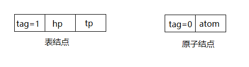
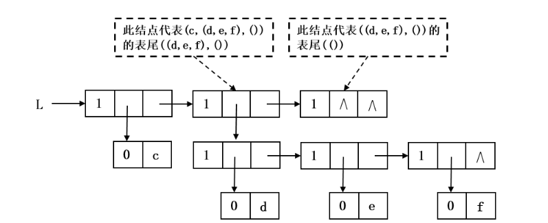
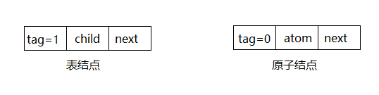
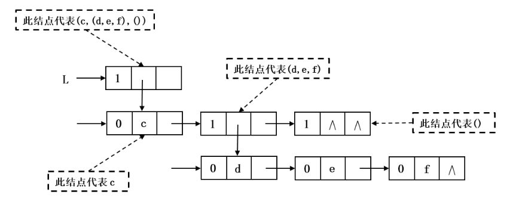

# 广义表

## 基本定义

**广义表**也叫**列表**，是**线性表的推广**，是一种**递归定义**的数据结构。

线性表的元素只能是**原子（单个数据）**，而广义表的元素既可以是**原子**，也可以是**另一个广义表**。

**形式表示**

广义表记作：$LS=(a_1,a_2,\dots,a_n)$


- LS：广义表名称
- $a_i$：表元素，**原子** 或 **子表**
- n：表长度（元素个数），\(n=0\) 称为**空表**

**原子**：不可再分割的基本数据（如数字、字符）；

**子表**：本身又是一个广义表。

## 基础示例

约定：**小写表示原子，大写表示广义表**。

1. 空表：$A = ()$

   长度：0，无元素。

2. 纯原子表（等价普通线性表）：$B = (a,\ b,\ c)$

   长度：3，元素全是原子。

3. 含子表：$C = (a,\ (b,c),\ d)$

   长度：3

   - 第 1 个：原子 a

   - 第 2 个：子表 $(b,c)$

   - 第 3 个：原子 d

1. 多层嵌套：$D = ((a,b),\ c,\ (d,(e)))$

   长度：3，存在**多层子表**。

2. 递归表（自身嵌套，特殊广义表）:$E = (1,\ E)$

   展开：$E=(1,(1,(1,\dots)))$，无限嵌套。

## 核心术语

### 长度(length)

统计**最外层一级元素**个数，**不递归统计子表内部元素**。

例：$C=(a,(b,c),d)$，长度 = 3。

### 深度(depth)

表中**括号最大嵌套层数**（递归求深度）。

- 原子：深度 = 0
- 空表 $()$：深度 = 1
- 普通表：外层 + 子表最大深度

举例：

- $(a,b)$：深度 = 1
- $(a,(b,c))$：深度 = 2
- $((a,(b)),c)$：深度 = 3

### 表头(head)&表尾(tail)

设非空广义表 ：$LS=(a_1,a_2,\dots,a_n)$

- **表头 Head (LS)**：取出**第一个元素** $(a_1)$（可以是原子或子表）
- **表尾 Tail (LS)**：取出**除第一个元素外，剩余所有元素组成的新表**（**结果一定是表**）

> 关键结论：**任何非空表的表尾，一定还是广义表**。

**示例**

1. $L=(a,b,c)$

   - Head(L) = a（原子）

   - Tail(L) = $(b,c)$（表）


2. $L=(a,(b,c),d)$

   - Head(L) = a

   - Tail(L) = $((b,c),d)$


3. $L=((a,b),c)$

   - Head(L) = $(a,b)$（子表）

   - Tail(L) = $(c)$（表）


4. 极端：$L=(x)$

   - Head(L) = x

   - Tail(L) = $()$（空表）


利用表头 + 表尾可以**递归遍历整个广义表**。

## 存储结构（重点）

广义表**不适合顺序存储**（元素类型不定、嵌套复杂），工程上一律使用**链式存储**。

主流两种链表结构：**头尾表示法**、**扩展线性链表（孩子兄弟表示法）**

### 1. 头尾链表表示法

每个节点分两类：**原子节点**、**表节点**，用**标志位**区分。

标志位使用枚举表示：

```c
typedef enum {
    ATOM,
    LIST 
} GLTag; //ATOM==0:表示原子,LIST==1:表示子表
```

#### 结点结构

+ **表结点：**代表广义表或子表，它的`hp`(head pointer)指针指向表头，`tp`(tail pointer)指向表尾，这是一种分支结点。

+ **原子结点：**用于存储数据，指向它的指针是`hp`，它是链尾的表结点，省去了收尾指针



结点结构用C语言表示为：

```c
typedef struct GLNode {
	GLTag tag; 		//公共部分，用以区分原子部分和表结点
	union { 			//原子部分和表结点的联合部分
		AtomType atom; //atom是原子结点的值域,AtomType由用户定义
		struct { 
            struct GLNode *hp;
            struct GLNode *tp;
        } ptr;
		// ptr是表结点的指针域,ptr.hp 和ptr.tp分别指向表头和表尾
		};
} *Glist; //广义表类型
```

例如，对于广义表$L = ( c , ( d , e , f ) , ( ) )$，它的头尾存储表示如下：



**示意图分析：**

1. 顶层是表节点：hp → 原子$c$，tp → 子表 $((d,e,f),())$
2. 子表$((d,e,f),())$又是表节点：hp → 子表 $(d,e,f)$，tp → 空表$()$
3. $(d,e,f)$继续拆分为表头 d、表尾 $(e,f)\dots$

#### 优缺点

- 优点：天然对应「表头 / 表尾」运算，算法直观。
- 缺点：节点类型多，结构复杂，同层元素不连续。

------

### 2. 扩展线性链表（孩子兄弟表示法，最常用）

统一节点结构，**所有节点形态一致**，用 `tag` 区分原子 / 子表。

#### 结点结构

+ **表结点：**它的`child`指针指向该表的第一个表元素结点，`next`指针指向同一层下一个表元素结点。
+ **原子结点：**用于存储数据，有`next`指针，指向同一层下一个表元素结点。



结点结构用C语言表示为：

```c
typedef struct GLNode
{
	GLTag tag;					/*!节点标志*/
	union {
		ElemType atom;			/*!存储数据*/
		struct GLNode* child;	/*!孩子列表*/
	}data;
	struct GLNode* next;		/*!指向下级节点*/
} GLNode;
```

例如，对于广义表$L = ( c , ( d , e , f ) , ( ) )$，它的扩展线性链表储表示如下：



#### 特点

1. 节点格式统一，编码简单，是教材、工程最常用实现。
2. 同时可以**兼容表示树结构**（广义表与树可相互转换）。
3. 遍历、插入、删除操作实现简单。

## 代码实现

### GeneralList.h

```c
/*****************************************************************//**
 * \file   GeneralList.h
 * \brief   广义表（general Lists）.
 * 
 * \author Maye
 * \date   May 2026
 *********************************************************************/
#pragma once

#include <stdbool.h>

typedef char ElemType;

typedef enum GLTag {
	TagAtom = 0,
	TagList = 1
}GLTag;

/**
 * 广义表（general Lists）结构.
 */
typedef struct GLNode
{
	GLTag tag;					/*!节点标志*/
	union {
		ElemType atom;			/*!存储数据*/
		struct GLNode* child;	/*!孩子列表*/
	}data;
	struct GLNode* next;		/*!指向下级节点*/
} GLNode;


GLNode* gl_node_alloc();
GLNode* gl_node_alloc2(int tag, ElemType atom);
void gl_node_free(GLNode* node);

/**
 * 通过字符串创建广义表.
 */
GLNode* gl_create(char** str);

void gl_destroy(GLNode* root);

bool gl_empty(GLNode* root);

int gl_length(GLNode* root);

int gl_depth(GLNode* root);

GLNode* gl_head(GLNode* root);

GLNode* gl_tail(GLNode* root);


GLNode* gl_get_atom(GLNode* root, int index);
void gl_set_atom(GLNode* root, int index, ElemType atom);

GLNode* gl_get_list(GLNode* root, int index);
void gl_set_list(GLNode* root, int index, GLNode* list);

GLNode* gl_find(GLNode* root, ElemType atom);

/**
 * 查找所有匹配的原子（扩展功能）
 * @param root 广义表根节点
 * @param atom 要查找的原子
 * @param results 用于存储结果的数组
 * @param size 数组大小
 * @return 找到的原子数量
 */
int gl_find_all(GLNode* root, char atom, GLNode** results, int size);

/////////////////////高级/////////////////////
void gl_add_child(GLNode* root, GLNode* child);

void gl_add_siblings(GLNode* root, GLNode* next);

void gl_print(GLNode* root);

void gl_print_self(GLNode* root);

GLNode* gl_copy(GLNode* root);
```

### GeneralList.c

```c
#include "GeneralList.h"
#include <stdlib.h>
#include <stdio.h>
#include <assert.h>

GLNode* gl_node_alloc()
{
	GLNode* node = calloc(1, sizeof(GLNode));
    if (!node) {
        printf("gl_node_alloc failed\n");
        return NULL;
    }
    node->tag = TagList;
    //printf("alloc node %p\n",node);
    return node;
}

GLNode* gl_node_alloc2(int tag, ElemType atom)
{
    GLNode* node = gl_node_alloc();
    if (!node) {
        return NULL;
    }
    node->tag = tag;
    node->data.atom = atom;
    return node;
}

void gl_node_free(GLNode* node)
{
    if (!node) {
        return;
    }
	//printf("free node %p %d %c\n", node, node->tag, node->data.atom);
    free(node);
}

static char get_char(char** str) {
    return **str;
}

static char** move_char(char** str,int size) {
    *str += size;
    return str;
}

GLNode* gl_create(char** str)
{
    if (!str || !*str) {
        return NULL;
    }

    GLNode* node = NULL;
	char ch = get_char(str);
	move_char(str, 1);

    //递归解析字符串
    if (ch != '\0') {
		node = gl_node_alloc();     //创建新节点
        if (ch == '(') {          //左括号，解析子列表
            node->tag = TagList;    //标记为列表
			node->data.child = gl_create(str); //递归创建子表
        }
		else if (ch == ')') {         //右括号，结束解析子列表
            gl_node_free(node);
            node = NULL;
		}
        else {
            node->tag = TagAtom;    //标记为原子
            node->data.atom = ch;       //保存原子值
        }
	}

	ch = get_char(str);
	move_char(str, 1);
    if (node) {
		if (ch == ',') {
			node->next = gl_create(str); //递归创建下一个节点
        }
        else if(ch == ')') {
            node->next = NULL;
        }
    }

	return node;
}

void gl_destroy(GLNode* root)
{
    if (!root) {
        return;
    }

    //如果是列表，递归计算深度（计算每个孩子的深度，取最大值）
    GLNode* curNode = root;
    while (curNode) {
        if (curNode->tag == TagList) {
            gl_destroy(curNode->data.child);
        }
        GLNode* delNode = curNode;
        curNode = curNode->next;
		gl_node_free(delNode);
    }
}


bool gl_empty(GLNode* root)
{
    if (!root) {
        return true;
    }
    //空表必须是：表节点 + child 为空
    if (root->tag == TagAtom && !root->data.child) {
        return true;
    }
    return false;
}

int gl_length(GLNode* root)
{
    if (!root) {
        return 0;
    }

    int count = 0;
    GLNode* curNode =  root->data.child;
    while (curNode != NULL) {
        count++;
        curNode = curNode->next;
    }

    return count;
}

int gl_depth(GLNode* root)
{
    if (!root) {
        return 0;
    }

    //如果是原子，深度为0
    if (root->tag == TagAtom) {
        return 0;
    }

    int depth = 0;
    //如果是列表，递归计算深度（计算每个孩子的深度，取最大值）
	GLNode* curNode = root->data.child;
    while (curNode) {
        if (curNode->tag == TagList) {
            int curDepth = gl_depth(curNode);
            if (curDepth > depth) {
                depth = curDepth;
            }
        }
        curNode = curNode->next;
    }

    return depth + 1;
}

GLNode* gl_head(GLNode* root)
{
    //空表没有表头
    if (gl_empty(root)) {
        return NULL;
    }

    //原子不能求表头
    if (root->tag == TagAtom) {
        printf("Error: Atom can't get head\n");
        return NULL;
    }

    return root->data.child;
}

GLNode* gl_tail(GLNode* root)
{
    //空表没有表尾巴
    if (!root) {
        return NULL;
    }

    GLNode* head = gl_head(root);
    if (!head) {
        return NULL;
    }

	/*{
		// 表尾：去掉第一个元素后的剩余部分组成的表
		 // 创建一个新的表节点作为表尾
		GLNode* tail = gl_node_alloc();
		if (!tail) {
			return NULL;
		}

		tail->tag = TagList;
		// tail 的 child 指向剩余元素（即第一个元素的下一个节点）
		tail->data.child = head->next;
        return tail;
	}*/

	return head->next;
}

///////////////////////////////////////////////
/**
 * 获取指定位置的原子
 * @param root 广义表根节点
 * @param index 位置索引（从0开始）
 * @return 原子节点指针，失败返回NULL
 */
GLNode* gl_get_atom(GLNode* root, int index)
{
    if (!root || root->tag != TagList || index < 0) {
        printf("Error: Invalid parameters for gl_get_atom\n");
        return NULL;
    }
    
    // 遍历第一层元素
    GLNode* curNode = root->data.child;
    int curIndex = 0;
    
    while (curNode && curIndex < index) {
        curNode = curNode->next;
        curIndex++;
    }
    
    if (!curNode) {
        printf("Error: Index out of range in gl_get_atom\n");
        return NULL;
    }
    
    // 检查该位置是否是原子
    if (curNode->tag != TagAtom) {
        printf("Error: Element at index %d is not an atom\n", index);
        return NULL;
    }
    
    return curNode;
}

/**
 * 设置指定位置的原子值
 * @param root 广义表根节点
 * @param index 位置索引（从0开始）
 * @param atom 新的原子值
 */
void gl_set_atom(GLNode* root, int index, ElemType atom)
{
    GLNode* atomNode = gl_get_atom(root, index);
    if (atomNode) {
        atomNode->data.atom = atom;
    }
}

/**
 * 获取指定位置的子表
 * @param root 广义表根节点
 * @param index 位置索引（从0开始）
 * @return 子表节点指针，失败返回NULL
 */
GLNode* gl_get_list(GLNode* root, int index)
{
    if (!root || root->tag != TagList || index < 0) {
        printf("Error: Invalid parameters for gl_get_list\n");
        return NULL;
    }
    
    // 遍历第一层元素
    GLNode* curNode = root->data.child;
    int curIndex = 0;
    
    while (curNode && curIndex < index) {
        curNode = curNode->next;
        curIndex++;
    }
    
    if (!curNode) {
        printf("Error: Index out of range in gl_get_list\n");
        return NULL;
    }
    
    // 检查该位置是否是子表
    if (curNode->tag != TagList) {
        printf("Error: Element at index %d is not a list\n", index);
        return NULL;
    }
    
    return curNode;
}

/**
 * 在指定位置插入一个子表
 * @param root 广义表根节点
 * @param index 插入位置（从0开始）
 */
void gl_set_list(GLNode* root, int index, GLNode* newList)
{
    if (!root || root->tag != TagList || index < 0 || !newList) {
        printf("Error: Invalid parameters for gl_set_list\n");
        return;
    }
    
    // 特殊情况：插入到第一个位置
    if (index == 0) {
        newList->next = root->data.child;
        root->data.child = newList;
        return;
    }
    
    // 找到插入位置的前一个节点
    GLNode* prevNode = root->data.child;
    int curIndex = 0;
    
    while (prevNode && curIndex < index - 1) {
        prevNode = prevNode->next;
        curIndex++;
    }
    
    if (!prevNode) {
        printf("Error: Index out of range in gl_set_list\n");
        gl_node_free(newList);
        return;
    }
    
    // 插入新节点
    newList->next = prevNode->next;
    prevNode->next = newList;
}

/**
 * 查找指定原子在广义表中的位置
 * @param root 广义表根节点
 * @param atom 要查找的原子
 * @return 找到的第一个原子节点指针，未找到返回NULL
 */
GLNode* gl_find(GLNode* root, ElemType atom)
{
    if (!root) {
        return NULL;
    }
    
    // 如果是原子，比较值
    if (root->tag == TagAtom) {
        if (root->data.atom == atom) {
            return root;
        }
    }
    // 如果是列表，递归查找其子表
    else if (root->tag == TagList) {
        // 遍历当前层的所有元素
        GLNode* curNode = root->data.child;
        while (curNode) {
            GLNode* found = gl_find(curNode, atom);
            if (found) {
                return found;
            }
            curNode = curNode->next;
        }
    }
    
    return NULL;
}

/**
 * 查找所有匹配的原子（扩展功能）
 * @param root 广义表根节点
 * @param atom 要查找的原子
 * @param results 用于存储结果的数组
 * @param size 数组大小
 * @return 找到的原子数量
 */
int gl_find_all(GLNode* root, char atom, GLNode** results, int size)
{
    if (!root || !results || size <= 0) {
        return 0;
    }
    
    int count = 0;
    
    // 如果是原子，比较值
    if (root->tag == TagAtom) {
        if (root->data.atom == atom && count < size) {
            results[count++] = root;
        }
    }
    // 如果是列表，递归查找其子表
    else if (root->tag == TagList) {
        GLNode* curNode = root->data.child;
        while (curNode && count < size) {
            count += gl_find_all(curNode, atom, results + count, size - count);
            curNode = curNode->next;
        }
    }
    
    return count;
}

/////////////////////高级/////////////////////
void gl_add_child(GLNode* root, GLNode* child)
{
	if (!root || !child) {
		return;
	}

	if (!root->data.child) {
		root->data.child = child;
	}
	else {
		gl_add_siblings(root->data.child, child);
	}
}

void gl_add_siblings(GLNode* root, GLNode* next)
{
	if (!root || !next) {
		return;
	}

	if (!root->next) {
		root->next = next;
	}
	else {
		gl_add_siblings(root->next, next);
	}
}
void gl_print(GLNode* root)
{
    if (!root) {
        return;
    }

    //如果是列表
    if (root->tag == TagList) {
        printf("(");
        //递归打印孩子
        gl_print(root->data.child);
        printf(")");
    }
    //如果是原子，直接打印
    else {
        printf("%c", root->data.atom);
    }

    //如果有后继节点
    if (root->next) {
        printf(",");
        gl_print(root->next);
    }
}

void gl_print_self(GLNode* root)
{
    if (!root) {
        return;
    }

    //如果是列表
    if (root->tag == TagList) {
        printf("(");
        //递归打印孩子
        gl_print(root->data.child);
        printf(")");
    }
    //如果是原子，直接打印
    else {
        printf("%c", root->data.atom);
    }
}

GLNode* gl_copy(GLNode* root)
{
	if (!root) {
		return NULL;
	}

	GLNode* node = gl_node_alloc();
	node->tag = root->tag;
	if (root->tag == TagAtom) {
		node->data.atom = root->data.atom;
	}
	else {
		node->data.child = gl_copy(root->data.child);
	}
	node->next = gl_copy(root->next);
	return node;
}
```

### test.c

```c
void test_generalList(const char* str)
{
	GLNode* glRoot = gl_create(str);
	if (!glRoot) {
		printf("is not a general list\n");
		return;
	}

	printf("--->");
	gl_print(glRoot);
	printf("\n");
	printf("length:%d\n", gl_length(glRoot));
	printf("depth:%d\n", gl_depth(glRoot));

	printf("head:");
	gl_print_self(gl_head(glRoot));
	printf("\ntail:");
	gl_print(gl_tail(glRoot));

	printf("\n");

	 {
		GLNode* newGl = gl_copy(glRoot);

		printf("newGl--->");
		gl_print(newGl);
		printf("\n");

		gl_destroy(newGl);
	}

	gl_destroy(glRoot);
}

int main()
{
	const char* str_list[] = { "","()","(a)","(a,(b,c,d))","(a,(b,c,d),e)","((a,b),(c),d,((e,f),g))"};
	for (int i = 0; i < sizeof(str_list) / sizeof(char*); i++) {
		test_generalList_2(str_list[i]);
	}
	return 0;
}
```

输出结果如下：

```css
============Testing:
Created:
Length: 0
Depth: 0
Head:
Tail:
Error: Invalid parameters for gl_get_atom
============Testing: ()
Created: ()
Length: 0
Depth: 1
Head:
Tail:
Error: Index out of range in gl_get_atom
============Testing: (a)
Created: (a)
Length: 1
Depth: 1
Head: a
Tail:
Atom at index 0: a
============Testing: (a,(b,c,d))
Created: (a,(b,c,d))
Length: 2
Depth: 2
Head: a
Tail: (b,c,d)
Atom at index 0: a
Found atom c
============Testing: (a,(b,c,d),e)
Created: (a,(b,c,d),e)
Length: 3
Depth: 2
Head: a
Tail: (b,c,d),e
Atom at index 0: a
Found atom c
============Testing: ((a,b),(c),d,((e,f),g))
Created: ((a,b),(c),d,((e,f),g))
Length: 4
Depth: 3
Head: (a,b)
Tail: (c),d,((e,f),g)
Error: Element at index 0 is not an atom
Found atom c
```

