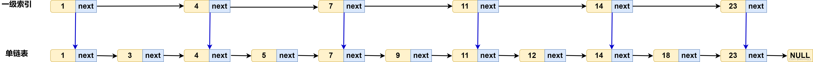
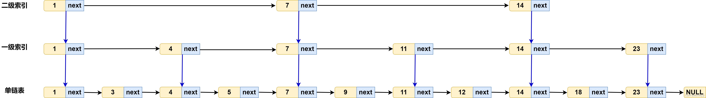
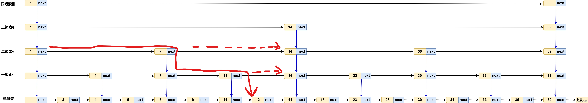

[跳表的原理与实现 [图解\]_跳表实现-CSDN博客](https://blog.csdn.net/Appleeatingboy/article/details/119948340)

[(96 封私信 / 71 条消息) 读懂Redis：从源码分析其跳表实现 - 知乎](https://zhuanlan.zhihu.com/p/666229986)

https://developer.aliyun.com/article/1418536

# 跳表

**跳表（Skip List）** 是一种基于有序单链表的数据结构，通过多级索引实现高效的查找、插入和删除操作。跳表的核心思想是利用二分查找的方式，在有序链表的基础上建立多级索引，从而显著提高操作效率。

跳表的前提是底层链表必须是 **有序的**，因为只有在有序链表的基础上，才能通过索引快速定位目标节点。例如，Redis 的有序集合（Sorted Set）就是通过跳表实现的，其底层链表按照分数（Score）从小到大排序。

## 跳表原理

对于单链表，即使是 存储的**有序数据（即 有序链表）**，想在其中查找某个数据，也只能从头到尾遍历，查找效率低，时间复杂度是O(n)，如下图所示


**怎么才能提高查找效率呢？** 

为了提高查找效率，使用二分查找的思想，对有序链表建立一级“索引”。 每两个节点提取一个节点到索引层。 索引层中的每个节点 都包含两个指针，一个指向下一个节点，一个down指针，指向下一级节点。


假设要查找图中 18这个节点：

首先在一级索引层遍历，当遍历到14这个节点的时候，发现其下一个节点是23，则要查找的18就在14和23之间。 然后，通过14节点的 down 指针，下降到原始链表这一层，继续在原始链表中遍历。 此时，只需要在原始链表中，遍历两个节点，14和18,就找到18这个节点了。    查找18这个节点，在原始链表需要遍历10个节点，现在只需要遍历7个节点（一级索引层遍历5个节点，原始链表遍历2个节点）。 

从以上示例可以看出，加上一层索引之后，查找一个节点的遍历节点数减少了，效率提高了。如果再增加一级索引，那么效率会不会更高呢？

**建立二级索引**

与建立一级索引的方式类似，在第一级索引的基础上，每两个节点抽出一个节点到第二级索引，如下图：



 现在如果要查找18节点，只需要遍历6个节点（二级索引层遍历3个节点，一级索引层1个节点，原始链表2个节点）。

通过建立索引的方式，对于数据量越大的有序链表，通过建立多级索引，查找效率提升会非常明显。

这种**链表加多级索引的结构** 就是 **跳表**。

## 跳表复杂度

### 时间复杂度

跳表的搜索效率之所以高，是因为它减少了需要遍历的节点数量。在一个普通的有序链表中，搜索一个元素需要从头节点开始逐个遍历，时间复杂度为 O(n)。而在跳表中，每次搜索可以跳过一些节点，从而达到类似二分搜索的效果。

跳表的多级索引结构是这样构建的：假设原始链表有 n 个元素，那么第一级索引大约有 n/2 个元素，第二级索引大约有 n/4 个元素，以此类推。如果跳表有 h 层索引，最高层索引有 2 个节点，那么可以得出 n/2^h = 2，解得 h = log2(n) - 1。包括原始链表层，整个跳表的高度是 log2(n)。

在跳表中搜索一个元素时，每一层索引最多需要遍历的节点数是固定的。例如，如果每两个节点抽取一个节点作为上一级索引的节点，那么每一层索引最多遍历 3 个节点。因此，跳表中搜索一个元素的时间复杂度为 O(3 * log2(n))，忽略常数因子后，时间复杂度为 O(log n)。




### 空间复杂度

虽然跳表在时间复杂度上有优势，但它牺牲了空间复杂度。

建立索引后的总的索引点的空间复杂度：
$$
n/2+n/4+n/8+\dots+2=n-2
$$
跳表的空间复杂度为 O(n)，因为除了原始链表的 n 个节点外，还需要额外的空间来存储索引节点。

不过，可以通过调整索引层的密度来降低空间复杂度。例如，如果每三个节点抽取一个节点作为索引，那么空间复杂度可以减少到 O(n/2)。

## 跳表实现

### SkipList.h

```c
#pragma once

#include <stdbool.h>

#define SKIPLIST_MAXLEVEL 32
#define SKIPLIST_P 0.25
#define SKIPLIST_STATIC_ARRAY

typedef int ElemType;

typedef struct SkipListNode
{
	ElemType data;					// 元素
	struct SkipListNode* prev;		// 后退指针：只有底层有
#ifndef SKIPLIST_STATIC_ARRAY
	struct SkipListNode** next;		// 前进指针
#else
	struct SkipListNode* next[SKIPLIST_MAXLEVEL];		// 前进指针
#endif
	int level;						// 当前节点的高度(节点最高在多少层)
}SkipListNode;

typedef struct SkipList
{
	SkipListNode* head;
	SkipListNode* tail;
	unsigned long size;
	int max_level;		/*!跳表最大层数*/
} SkipList;

//创建跳表
SkipList* skip_list_create();

void skip_list_destroy(SkipList* sl);

SkipListNode* skip_list_insert(SkipList* sl,ElemType data);

bool skip_list_remove(SkipList* sl, ElemType data);
int skip_list_remove_all(SkipList* sl, ElemType data);


/**
 * 根据数据获取元素.
 */
SkipListNode* skip_list_get_by_value(SkipList* sl,ElemType data);

void skip_list_clear(SkipList* sl);
bool skip_list_empty(SkipList* sl);
unsigned long skip_list_size(SkipList* sl);


///////////////////高级/测试////////////////////////
void skip_list_print(SkipList* sl);
SkipList* skip_list_copy(SkipList* sl);
```

### SkipList.c

```c
#include "SkipList.h"
#include <stdlib.h>
#include <stdio.h>
#include <limits.h>
#include <string.h>

static SkipListNode* skip_list_node_create(int level, ElemType data)
{
	SkipListNode* node = (SkipListNode*)calloc(1, sizeof(SkipListNode));
    if (!node) {
        return NULL;
    }
    node->data = data;
	node->level = level;

#ifndef SKIPLIST_STATIC_ARRAY
	// 为每层指针分配空间
	node->next = calloc(level, sizeof(SkipListNode*));
	if (!node->next) {
		free(node);
		return NULL;
	}
#endif
    return node;
}

static void skip_list_node_free(SkipListNode* node) {
	if (!node) {
		return;
	}

#ifndef SKIPLIST_STATIC_ARRAY
	free(node->next);	//释放数组
#endif
	free(node);			//释放节点
}

// 随机生成节点层数（核心：抛硬币决定是否升层）
static int skip_list_random_level()
{
    int level = 1;
    while ((rand() & 0xFFFF) < (SKIPLIST_P * 0xFFFF)) {
        level++;
    }
    return (level < SKIPLIST_MAXLEVEL) ? level : SKIPLIST_MAXLEVEL;
}

SkipList* skip_list_create()
{
    SkipList* sl = (SkipList*)calloc(1,sizeof(SkipList));
    if (!sl) {
        return NULL;
    }
    sl->max_level = 1;
    sl->size = 0;

    //创建头结点
	sl->head = skip_list_node_create(SKIPLIST_MAXLEVEL, 0);
    sl->tail = sl->head;
    return sl;
}

void skip_list_destroy(SkipList* sl)
{
    if (!sl) {
        return;
    }
    skip_list_clear(sl);

	skip_list_node_free(sl->head);
    free(sl);
}

SkipListNode* skip_list_insert(SkipList* sl, ElemType data)
{
	//保存每一层需要修改的前驱节点
	SkipListNode* update[SKIPLIST_MAXLEVEL] = { NULL };

	SkipListNode* curNode = sl->head;
    
	//1.从最高层往下查找插入位置
    for (int i = sl->max_level - 1; i >= 0; i--) {
		//遍历当前层所有节点，直到找到第一个大于data的节点(新节点插入到该节点之前)
		while (curNode->next[i] && curNode->next[i]->data < data) {
			curNode = curNode->next[i];
		}
		//记录每一层的前驱节点
		update[i] = curNode;
    }

	// 重复值不插入
	curNode = curNode->next[0]; // 注意：此时 for 循环结束后，curNode 就是 update[0]
	if (curNode != NULL && curNode->data == data) {
		return NULL;
	}

	//2,随机生成节点层数(新节点插入哪些层)
    int newLevel = skip_list_random_level();
    //如果新节点层数大于当前层数，则更新头结点
    if (newLevel > sl->max_level) {
		//将超出的前驱设置为头指针
        for (int i = sl->max_level; i < newLevel; i++) {
            update[i] = sl->head;
        }
		//更新当前跳表总层数
        sl->max_level = newLevel;
    }

    //创建新节点，并插入到各层
    SkipListNode* newNode = skip_list_node_create(newLevel, data);
    for (int i = 0; i < newLevel; i++) { 
		newNode->next[i] = update[i]->next[i];
		update[i]->next[i] = newNode;
    }

    //设置prev指针
	newNode->prev = (update[0] == sl->head) ? NULL : update[0];
    if (newNode->next[0]) {
        newNode->next[0]->prev = newNode;
    }
    else {
        sl->tail = newNode;
    }
    sl->size++;
    return newNode;
}

bool skip_list_remove(SkipList* sl, ElemType data)
{
	if (sl->size == 0) 
		return false;

	SkipListNode* update[SKIPLIST_MAXLEVEL] = {0};

	SkipListNode* curNode = sl->head;

	//1, 查找要删除的节点
	for (int i = sl->max_level - 1; i >= 0; i--) {
		while (curNode->next[i] != NULL && curNode->next[i]->data < data) {
			curNode = curNode->next[i];
		}
		update[i] = curNode;
	}

	//2,定位要删除的节点
	curNode = curNode->next[0];

	//3,如果节点不存在直接返回
	if (!curNode || curNode->data != data) {
		return false;
	}

	//4,从每一层删除该节点
	for (int i = 0; i < sl->max_level; i++) {
		if (update[i]->next[i] == curNode) {
			update[i]->next[i] = curNode->next[i];
		}
	}

	//5, 更新底层双向链表
	if (curNode->next[0] != NULL) {
		curNode->next[0]->prev = curNode->prev;
	}
	else {
		// 删除的是尾节点
		sl->tail = curNode->prev;
	}

	//6, 释放节点
	skip_list_node_free(curNode);
	sl->size--;

	//7， 降低跳表层数（如果顶层已空）
	while (sl->max_level > 1 && sl->head->next[sl->max_level - 1] == NULL) {
		sl->max_level--;
	}
	return true;
}

int skip_list_remove_all(SkipList* sl, ElemType data)
{
	if (sl->size == 0) return 0;
    
#if 0
    int removedCount = 0;
    
    // 持续删除直到找不到
    while (skip_list_remove(sl, data)) {
        removedCount++;
    }
    
    return removedCount;
#else
	SkipListNode* update[SKIPLIST_MAXLEVEL] = {0};

	SkipListNode* curNode = sl->head;

	//1, 查找要删除的节点的前驱节点
	for (int i = sl->max_level - 1; i >= 0; i--) {
		while (curNode->next[i] != NULL && curNode->next[i]->data < data) {
			curNode = curNode->next[i];
		}
		update[i] = curNode;
	}

	//4,如果节点不存在直接返回
	if (!curNode->next[0] || curNode->next[0]->data != data) {
		return false;
	}

	//4,从每一层删除该节点
	SkipListNode* firstNode = curNode->next[0];	//要删除的第一个节点
	SkipListNode* lastNode = curNode->next[0];	//要删除的最后一个节点
	for (int i = 0; i < sl->max_level; i++) {
		if (update[i]->next[i] && update[i]->next[i]->data == data) {
			//找到每一层要删除的最后一个节点的下一个节点
			while (lastNode && lastNode->data == data) {
				lastNode = lastNode->next[i];
			}
			//将第一个要删除的节点的前驱节点的 next 指向最后一个要删除的节点
			update[i]->next[i] = lastNode;
		}
	}

	//5, 更新底层双向链表
	if (lastNode != NULL) {
		lastNode->prev = update[0];
	}
	else {
		// 删除的是尾节点
		sl->tail = lastNode;
	}

	//6, 释放节点
	//lastNode->next[0] = NULL;
	while (firstNode != lastNode) {
		SkipListNode* del = firstNode;
		firstNode = firstNode->next[0];
		skip_list_node_free(del);
		sl->size--;
	}

	//7， 降低跳表层数（如果顶层已空）
	while (sl->max_level > 1 && sl->head->next[sl->max_level - 1] == NULL) {
		sl->max_level--;
	}
	return true;

#endif
}

SkipListNode* skip_list_get_by_value(SkipList* sl, ElemType data)
{
	if (sl->size == 0) {
		return NULL;
	}

	SkipListNode* x = sl->head;

	// 1. 从最高层往下，寻找小于目标值的最大节点（也就是查找节点的前一个节点）
	for (int i = sl->max_level - 1; i >= 0; i--) {
		while (x->next[i] && x->next[i]->data < data) {
			x = x->next[i];
		}
	}
	// 2. 此时 x 停留在最底层（Level 0）的前驱节点
	// 检查 x 的下一个节点是不是我们要找的
	x = x->next[0];
	if (x && x->data == data) {
		return x;
	}
	return NULL;
}

void skip_list_clear(SkipList* sl)
{
	//空
	if (sl->head == sl->tail) {
		return;
	}

	SkipListNode* x = sl->tail;
	while (x && x != sl->head) {
		SkipListNode* del = x;
		x = del->prev;
		skip_list_node_free(del);
	}
	sl->size = 0;
	sl->max_level = 1;
	for (int i = 0; i < SKIPLIST_MAXLEVEL; i++) {
		sl->head->next[i] = NULL;
	}
	sl->head->prev = NULL;
	sl->tail = sl->head;
}

bool skip_list_empty(SkipList* sl)
{
	return sl->head == sl->tail;
}

unsigned long skip_list_size(SkipList* sl)
{
	return sl->size;
}

void skip_list_print(SkipList* sl)
{
	printf("\n=== 跳表结构 ===\n");
	if (sl->head == sl->tail) {
		printf("空跳表\n");
		return;
	}

	printf("总节点数: %lu, 最大层数: %d\n", sl->size, sl->max_level);

	for (int i = sl->max_level - 1; i >= 0; i--) {
		printf("Level %d: ", i);
		SkipListNode* x = sl->head->next[i];
		while (x) {
			printf("%d ", x->data);
			x = x->next[i];
		}
		printf("\n");
	}

	// 打印双向链表结构（底层）
	printf("\n底层双向链表: ");
	SkipListNode* x = sl->head->next[0];
	while (x) {
		printf("->(%d) ", x->data);
		x = x->next[0];
	}
	printf("\n");
}

//高效的深拷贝（将时间复杂度从 O(N^2) 降回 O(N)），核心思想是“空间换时间”
SkipList* skip_list_copy(SkipList* sl) {
    if (!sl || sl->size == 0) return NULL;

    SkipList* newSl = skip_list_create();
    newSl->max_level = sl->max_level;
    newSl->size = sl->size;

    unsigned long n = sl->size;
    // 分配两个辅助数组
    SkipListNode** src_arr = (SkipListNode**)calloc(n, sizeof(SkipListNode*));
    SkipListNode** dst_arr = (SkipListNode**)calloc(n, sizeof(SkipListNode*));
    if (!src_arr || !dst_arr) {
        free(src_arr); free(dst_arr);
        skip_list_destroy(newSl);
        return NULL;
    }

    // 1. 拷贝底层并填充数组
    SkipListNode* srcCur = sl->head->next[0];
    SkipListNode* dstPre = newSl->head;
    unsigned long idx = 0;

    while (srcCur) {
        // ⚠️ 注意：你的原结构体没有保存单个节点的 level，这里只能默认用最大层数
		SkipListNode* newNode = skip_list_node_create(srcCur->level, srcCur->data);
        
        newNode->prev = dstPre;
        dstPre->next[0] = newNode;

        src_arr[idx] = srcCur;
        dst_arr[idx] = newNode;
        
        dstPre = newNode;
        srcCur = srcCur->next[0];
        idx++;
    }
    newSl->tail = dstPre;

    // 2. O(N) 重建上层索引
    for (int lv = 1; lv < sl->max_level; lv++) {
        SkipListNode* srcNode = sl->head;
        SkipListNode* dstNode = newSl->head;

        while (srcNode->next[lv]) {
            SkipListNode* srcNext = srcNode->next[lv];

            // 二分查找或线性查找 srcNext 在 src_arr 中的位置
            // 因为数据量可能很大，用二分查找将这一步变成 O(log N)
            int left = 0, right = n - 1, pos = -1;
            while (left <= right) {
                int mid = left + (right - left) / 2;
                if (src_arr[mid] == srcNext) {
                    pos = mid;
                    break;
                } else if (src_arr[mid]->data < srcNext->data) {
                    left = mid + 1;
                } else {
                    right = mid - 1;
                }
            }

            if (pos != -1) {
                dstNode->next[lv] = dst_arr[pos];
                dstNode = dst_arr[pos];
            }
            
            srcNode = srcNext;
        }
        dstNode->next[lv] = NULL;
    }

    free(src_arr);
    free(dst_arr);
    return newSl;
}
```

### test_skiplist.c

```c
#include <stdio.h>
#include <time.h>
#include <stdlib.h>
#include "SkipList.h"


void test_skip_list_1()
{
	SkipList* sl = skip_list_create();

	skip_list_insert(sl, 1);
	skip_list_insert(sl, 3);
	skip_list_insert(sl, 2);
	skip_list_insert(sl, 4);
	skip_list_insert(sl, 2);
	skip_list_insert(sl, 2);

	skip_list_print(sl);

	skip_list_remove_all(sl, 2);
	skip_list_remove(sl, 4);

	//skip_list_get_by_value(sl, 3);
	//skip_list_get_by_value(sl, 0);
	skip_list_get_by_value(sl, 10);

	skip_list_print(sl);

	skip_list_destroy(sl);
}


void test_skip_list_copy()
{
	printf("=====%s=====\n",__FUNCTION__);

	SkipList* sl = skip_list_create();

	for (size_t i = 1; i < 30; i++) {
		skip_list_insert(sl, i);
	}

	printf("src:");
	skip_list_print(sl);

	SkipList* sl_copy = skip_list_copy(sl);

	printf("copy:");
	skip_list_print(sl_copy);

	skip_list_destroy(sl_copy);
	skip_list_destroy(sl);
}

int main()
{
	srand(time(NULL));

	test_skip_list_1();
	test_skip_list_copy();
	return 0;
}
```

输出结果如下：

```css
=== 跳表结构 ===
总节点数: 4, 最大层数: 9
Level 8: 3
Level 7: 3
Level 6: 3
Level 5: 3
Level 4: 3
Level 3: 3
Level 2: 3
Level 1: 2 3
Level 0: 1 2 3 4

底层双向链表: ->(1) ->(2) ->(3) ->(4)

=== 跳表结构 ===
总节点数: 2, 最大层数: 9
Level 8: 3
Level 7: 3
Level 6: 3
Level 5: 3
Level 4: 3
Level 3: 3
Level 2: 3
Level 1: 3
Level 0: 1 3

底层双向链表: ->(1) ->(3)
=====test_skip_list_copy=====
src:
=== 跳表结构 ===
总节点数: 29, 最大层数: 3
Level 2: 14 27 28
Level 1: 8 10 14 15 18 19 23 26 27 28
Level 0: 1 2 3 4 5 6 7 8 9 10 11 12 13 14 15 16 17 18 19 20 21 22 23 24 25 26 27 28 29

底层双向链表: ->(1) ->(2) ->(3) ->(4) ->(5) ->(6) ->(7) ->(8) ->(9) ->(10) ->(11) ->(12) ->(13) ->(14) ->(15) ->(16) ->(17) ->(18) ->(19) ->(20) ->(21) ->(22) ->(23) ->(24) ->(25) ->(26) ->(27) ->(28) ->(29)
copy:
=== 跳表结构 ===
总节点数: 29, 最大层数: 3
Level 2: 14 27 28
Level 1: 8 10 14 15 18 19 23 26 27 28
Level 0: 1 2 3 4 5 6 7 8 9 10 11 12 13 14 15 16 17 18 19 20 21 22 23 24 25 26 27 28 29

底层双向链表: ->(1) ->(2) ->(3) ->(4) ->(5) ->(6) ->(7) ->(8) ->(9) ->(10) ->(11) ->(12) ->(13) ->(14) ->(15) ->(16) ->(17) ->(18) ->(19) ->(20) ->(21) ->(22) ->(23) ->(24) ->(25) ->(26) ->(27) ->(28) ->(29)
```