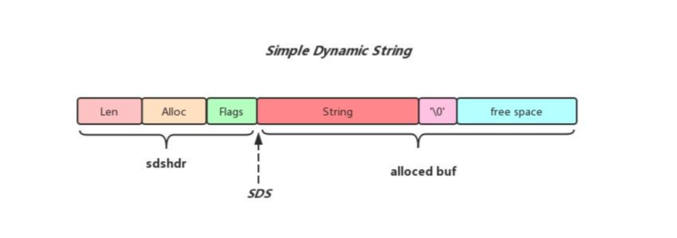
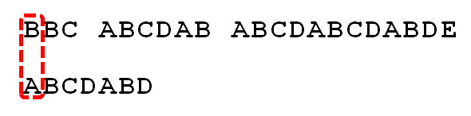
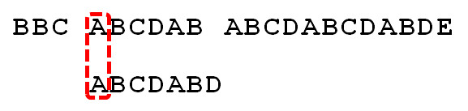
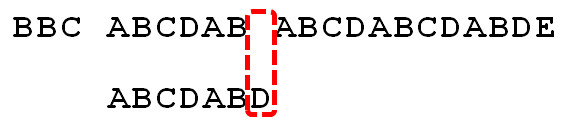
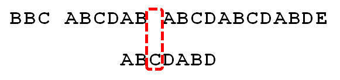
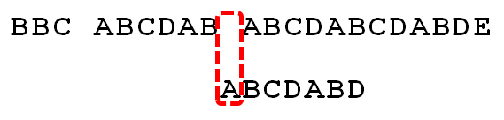
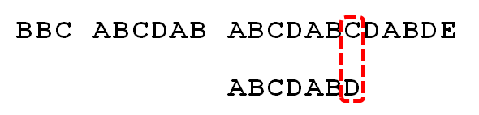
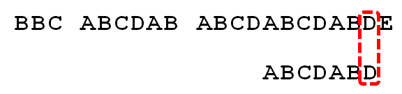

[(96 封私信 / 75 条消息) 字符串匹配算法（BM、KMP、BF、RK） - 知乎](https://zhuanlan.zhihu.com/p/625473716)

[字符串匹配算法精讲-CSDN博客](https://blog.csdn.net/paincupid/article/details/81159320)

# 串（String）

在数据结构中，**串（String）**，即字符串，是由零个或多个字符组成的有限序列。它是一种特殊的线性表，其数据元素被严格限定为字符（如ASCII或Unicode编码），且在语义上强调“整体性”与“不可分割性”，操作通常以子串为基本单位而非孤立字符。

## 核心基本概念

- **空串（null string）与空格串（blank string）**：长度为0的串称为空串（记为 `""`）；而包含一个或多个空格字符的串称为空格串，两者不同。
- **主串（master string）与子串（sub string）**：串中任意个连续字符组成的子序列称为该串的“子串”；包含子串的串称为“主串”。
- **串相等**：当且仅当两个串的长度相等，且对应位置上的字符完全一致时，这两个串才相等。

## 存储结构

串的物理实现主要有三种方式，体现了空间效率与时间效率之间的权衡：

1. **定长顺序存储（静态数组）**：使用固定长度的一维字符数组实现。优点是支持 O(1)*O*(1) 时间复杂度的随机访问，缓存局部性好；缺点是插入/删除需移动大量元素，且预分配空间易造成浪费或溢出。
2. **堆分配存储（动态数组）**：运行时在堆区动态申请连续内存空间并由指针管理。克服了长度限制，是现代高级语言（如Java的StringBuffer等）普遍采用的主流方式。
3. **链式存储（块链结构）**：采用链表节点存储固定长度的字符块。优势在于动态伸缩性强，适用于超长文本流式处理或频繁拼接场景；但无法随机访问，遍历开销大且额外指针域增加空间冗余。

## 基本运算

串的基本操作构成了文本处理的基础功能，主要包括：

- **基础操作**：初始化、赋值（StrAssign）、复制（StrCopy）、判空（StrEmpty）、求串长（StrLength）、销毁（DestroyString）。
- **内容操作**：串联接（Concat）、求子串（SubString）、插入（StrInsert）、删除（StrDelete）、替换（Replace）。
- **比较与定位**：串比较（StrCompare，按字典序逐字符比对ASCII值）和子串定位（Index，查找模式串在主串中的首次出现位置）。

## 核心算法：模式匹配

子串定位（模式匹配）是串处理的技术制高点，主要算法包括：

1. **朴素算法（BF, Brute-Force）**：采用穷举思想，主串与模式串从头逐位比对，失配时主串指针回溯，最坏时间复杂度高达 O(m×n)*O*(*m*×*n*) ，在恶意构造输入下性能会急剧恶化。
2. **KMP算法（Knuth-Morris-Pratt）**：通过预处理模式串构建“部分匹配表”（Next数组），记录前后缀最大重合长度。失配时仅移动模式串而不回溯主串指针，将时间复杂度优化至 O(m+n)*O*(*m*+*n*) ，深刻体现了利用已匹配信息消除冗余比较的计算思维。
3. **其他进阶算法**：如结合坏字符与好后缀规则从右向左匹配的 **BM算法**，以及引入哈希滚动技术的 **Rabin-Karp算法** 等，为工业级文本处理提供了更优的实践方案。

## 实际应用

串绝非简单的字符数组封装，它是连接理论算法与真实世界软件系统的枢纽桥梁。广泛应用于操作系统路径管理、编译原理的词法分析、Web开发中的URL解析与正则表达式引擎、搜索引擎的倒排文档检索，以及生物信息学中的DNA序列分析等领域。

## 简单动态字符串

**SDS（Simple Dynamic String，简单动态字符串）**是用于替代 C 语言原生字符串的核心底层数据结构。

### 为什么不用 C 语言原生字符串？

C 语言的字符串是以空字符 `\0` 结尾的字符数组。这种设计在处理数据库场景时存在严重缺陷：获取长度必须遍历整个字符串（耗时 O(N)*O*(*N*) ）、容易引发缓冲区溢出、不支持二进制安全等。为了克服这些瓶颈，我们设计了 SDS。

### SDS 的内部结构

SDS 是一种带有元信息（Header）的动态字符数组。SDS 的结构如下：

- 结构体包含三个字段：`len`（已使用的字节数）、`alloc`（总分配内存）和 `buf[]`（实际存储数据的字符数组）。通过维护 `alloc` 字段来减少内存重分配的次数。
- 空闲空间大小使用 `alloc - len`进行计算。



从上面插图可以看到sds由两部分构成，分别为sdshdr和alloced_buf，下面会分别说明：

sdshdr用来记录sds的一些元信息，包括sds中存储的字符串长度(Len字段记录)，以及sds已经分配用于存储字符串的alloced_buf的大小(Alloc字段记录)，为了尽可能的节省空间Redis将sdshdr的种类做了细分，根据字符串的长度不同，分配不同类型的sdshdr，不同sdshdr的大小也不一样

- Sdshdr5: 存储字符串长度区间为[0, 1<<5)之间, 没有Len和Alloc字段,只有一个Flags字段,整个sdshdr5占用1Byte
- Sdshdr8: 存储字符串长度区间为[1<<5, 1<<8)之间, Len和Alloc字段都占用1Byte, 整个sdshdr8占用3Bytes
- Sdshdr16:存储字符串长度区间为[1<<8, 1<<16)之间, Len和Alloc字段都占用2Bytes, 整个sdshdr16占用5Bytes
- Sdshdr32:存储字符串长度区间为[1<<16, 1<<32)之间, Len和Alloc字段都占用4Bytes, 整个sdshdr32占用9Bytes
- Sdshdr64:存储字符串长度区间为[1<<32, 1<<64]之间, Len和Alloc字段都占用8Bytes, 整个sdshdr64占用17Bytes

### SDS 相比 C 字符串的核心优势

- **获取长度 O(1)**：由于结构体头部直接记录了字符串的长度（`len`），程序无需像 C 字符串那样遍历到 `\0`，就能在常数时间内获取长度，避免了性能瓶颈。
- **防止缓冲区溢出**：当对字符串进行拼接或追加操作时，SDS 会先检查剩余空间是否满足需求。如果不足，SDS 会自动扩展内存，从根本上杜绝了 C 字符串常见的缓冲区溢出问题。
- **二进制安全**：C 字符串不能包含 `\0`，否则会被误判为结束。而 SDS 依赖 `len` 属性来判断数据边界，因此它可以存储任意格式的二进制数据（如图片、视频、序列化对象等），存入什么样子，读出就是什么样子。
- **兼容部分 C 函数**：尽管内部机制不同，SDS 底层的 `buf` 数组依然会以空字符 `\0` 结尾。这使得 SDS 能够无缝复用 `strcmp` 等标准的 C 语言字符串处理函数。

### 高效的内存管理机制

为了减少频繁修改字符串带来的内存重分配开销，SDS 采用了两种极其聪明的策略：

- **空间预分配策略**：在扩展空间时，SDS 不仅会分配所需的空间，还会额外分配一定的空闲空间。例如，若当前长度小于 1MB，则额外分配与当前长度相等的空闲空间；若大于等于 1MB，则额外分配 1MB 的空闲空间。
- **惰性空间释放策略**：当字符串缩短时，SDS 不会立即回收多出来的字节，而是将其转化为空闲空间（增加 `free` 或通过 `alloc` 记录），等待将来可能的增长操作使用。

## 简单动态字符串实现

### 结构定义

```c
/* sds 指向sdshdr中的buf*/
typedef char* sds;

/** sds头部 */
typedef struct sdshdr {
	size_t length;
	size_t capacity;
	char buf[];			/*!空数组，不占内存,仅作为后续内存访问标签*/
}sdshdr;
```

### sds.h

```c
sds sds_new_len(const char* str, size_t len);
sds sds_new(const char* str);
sds sds_new_empty();
sds sds_dup(const sds str);
void sds_free(sds s);

size_t sds_size(const sds str);
size_t sds_len(const sds str);
size_t sds_capacity(const sds str);

void sds_clear(sds str);
void sds_set_len(sds str,size_t len);
void sds_update_len(sds str);

/**
 * 获取str可用空间.
 */
size_t sds_avail(const sds str);
/**
 * 将sds字符串str的大小调整为能追加addlen的大小.
 * @param str sds字符串
 * @param addlen 需要追加的大小
 * @return 返回调整后的sds字符串，如果内存分配失败则返回NULL
 */
sds sds_make_room_for(sds str,size_t addlen);

sds sds_cat_len(sds dest, const char* src, size_t len);
sds sds_cat(sds dest, const char* src);

sds sds_cpy_len(sds dest, const char* src, size_t len);
sds sds_cpy(sds dest, const char* src);
```

### sds.c

```c
#include "sds.h"
#include <string.h>
#include <malloc.h>

/** 根据sds字符串获取sdshdr结构指针.  */
#define SDS_GET_HDR(str) ((sdshdr*)((char*)str - sizeof(sdshdr)))
/** 根据sdshdr指针获取sds指针.  */
#define SDS_GET_BUF(hdr) (sds)((char*)hdr + sizeof(sdshdr))

sds sds_new_len(const char* str, size_t len)
{
    //分配内存，正式分配内存为：底层实现结构长度(sizeof(sdshdr)) + 字符串长度 + 1(字符串结束符)
    sdshdr* sh = malloc(sizeof(sdshdr) + len + 1);
    if(!sh) {
        return NULL;
    }
    //保存字符串起始地址
	sds buf = SDS_GET_BUF(sh);

    sh->length = len;
	sh->capacity = len + 1;

    if (str && len) {
        memcpy(buf, str, len);
    }
    
    //字符串结束符
    buf[len] = '\0';
    return buf;
}

sds sds_new(const char* str)
{
	return sds_new_len(str, str ? strlen(str) : 0);
}

sds sds_new_empty()
{
    return sds_new_len("", 0);
}

sds sds_dup(const sds str)
{
	return sds_new_len(str, sds_len(str));
}

void sds_free(sds s)
{
    if (!s) {
        return;
    }
    free(SDS_GET_HDR(s));
}

size_t sds_size(const sds str)
{
    return SDS_GET_HDR(str)->length;
}

size_t sds_len(const sds str)
{
    return SDS_GET_HDR(str)->length;
}

size_t sds_capacity(const sds str)
{
    return SDS_GET_HDR(str)->capacity;
}

void sds_clear(sds str)
{
    SDS_GET_HDR(str)->length = 0;
}

void sds_set_len(sds str, size_t len)
{
    SDS_GET_HDR(str)->length = len;
}

void sds_update_len(sds str)
{
    sds_set_len(str, strlen(str));
}

size_t sds_avail(const sds str)
{
    sdshdr* sh = SDS_GET_HDR(str);
	return sh->capacity - sh->length - 1;
}

sds sds_make_room_for(sds str, size_t addlen)
{
	//获取可用空间
	size_t avail = sds_avail(str);
	//如果可用空间大于等于addlen，则不需要扩容
	if (avail >= addlen) {
		return str;
	}

	//计算新的字符串长度
	size_t newlen = sds_len(str) + addlen;
	//计算新的容量，使用倍增策略
	size_t capacity = newlen * 2 + 1;

	//重新分配内存
	sdshdr* newptr = (char*)realloc(SDS_GET_HDR(str), sizeof(sdshdr) + capacity);
	if (newptr == NULL) {
		return NULL;
	}
    newptr->capacity = capacity;

	return SDS_GET_BUF(newptr);
}

sds sds_cat_len(sds dest, const char* src, size_t len)
{
    size_t curLen = sds_len(dest);
    //预分配内存
	dest = sds_make_room_for(dest, len);
    if (!dest) {
        return NULL;
    }
    //拷贝内容到尾部
	memcpy(dest + curLen, src, len);

    //设置长度
    sds_set_len(dest, curLen + len);

	dest[curLen + len] = '\0';
    return dest;
}

sds sds_cat(sds dest, const char* src)
{
	return sds_cat_len(dest, src, strlen(src));
}

sds sds_cpy_len(sds dest, const char* src, size_t len)
{
    //判断sds空间是否大于len
	if (sds_capacity(dest) <= len) {
        dest = sds_make_room_for(dest, len- sds_len(dest));
        if (dest == NULL)
            return NULL;
    }

    memcpy(dest, src, len);

    dest[len] = '\0';

    sds_set_len(dest, len);
    return dest;
}

sds sds_cpy(sds dest, const char* src)
{
	return sds_cpy_len(dest, src, strlen(src));
}
```

### test_sds.c

```c
#include "sds.h"
#include <stdio.h>
#include <string.h>

void test_sds_1()
{
	//1，正常字符串
	{
		sds s1 = sds_new("hello");

		printf("s1 = %s\n", (s1));

		sds_free(s1);
	}

	//2,空字符串
	{
		sds s1 = sds_new("");

		printf("s1 = %s\n", (s1));

		sds_free(s1);
	}

	//3,空指针
	{
		sds s1 = sds_new(NULL);

		printf("s1 = %s\n", (s1));

		sds_free(s1);
	}
}

void test_sds_2()
{
	//cat
	printf("=====cat======\n");
	{
		sds s = sds_new("hello");

		printf("s = %s\n", (s));

		s = sds_cat_len(s, " world nice good", 6);

		printf("s = %s\n", (s));

		s = sds_cat(s, ",I'm fine,think's!");

		printf("s = %s\n", (s));

		sds_free(s);
	}

	//copy
	printf("=====copy======\n");
	{
		sds s = sds_new("hello");

		printf("s = %s\n", (s));

		s = sds_cpy_len(s, " world nice good", 6);

		printf("s = %s\n", (s));

		s = sds_cpy(s, ",I'm fine,think's!");

		printf("s = %s\n", (s));

		sds_free(s);
	}


	//cmp
	printf("=====cmp======\n");
	{
		sds s = sds_new("hello");

		printf("s = %s\n", (s));

		int ret = strncmp(s, "Hello,nice good", 5);
		printf("ret = %d\n", ret);

		printf("s = %s\n", (s));

		ret = strcmp(s, "Hello");
		printf("ret = %d\n", ret);

		printf("s = %s\n", (s));

		sds_free(s);
	}
}
```


# 字符串匹配算法

字符串匹配算法，是在实际工程中经常遇到的问题，也是各大公司笔试面试的常考题目。此算法通常输入为原字符串（string ）和子串（pattern），要求返回子串在原字符串中首次出现的位置。比如原字符串为“ABCDEFG”，子串为“DEF”，则算法返回3。常见的算法包括：BF（Brute Force，暴力检索）、RK（Robin-Karp，哈希检索）、KMP（教科书上最常见算法）、BM（Boyer Moore）、Sunday等，下面详细介绍。

## 一句话记住所有算法

1. **BF**：暴力逐个比，不行就回退
2. **RK**：用哈希值代替字符比较
3. **KMP**：利用前缀后缀，**不回退主串**
4. **BM**：从后往前比，**坏字符 + 好后缀**跳得最远
5. **Sunday**：只看窗口下一个字符，**跳得最快、代码最简单**

## 详细介绍（最易懂版）

### 1. BF 暴力匹配（Brute Force）

#### 算法特点

**最简单、最慢**

- 思想：主串、模式串一个一个字符比对
- 不匹配：主串回退一位，模式串回到开头
- 时间复杂度：**O(n\*m)**
- 优点：代码最简单
- 缺点：长文本效率极低

#### 代码实现

```c
/*
 * 暴力匹配算法：逐个字符比较，不匹配则主串回退，模式串归零
 * str：主串（自定义String结构体）
 * pattern：模式串（待查找的子串）
 * 返回：匹配成功返回起始下标，失败返回-1
 */
size_t sds_find_bf(const sds str, const char* pattern) {
    int n = sds_len(str), m = strlen(pattern); // n：主串长度，m：模式串长度
    int i = 0, j = 0;                        // i：主串指针，j：模式串指针

    // 逐个字符匹配
    while (i < n && j < m)
    {
        if (str[i] == pattern[j])     // 字符相等，指针同时后移
        {
            i++; j++;
        }
        else                                  // 不相等：回退指针
        {
            i = i - j + 1;                    // 主串回退到本次起始位置+1
            j = 0;                            // 模式串归零
        }
    }

    // j走完模式串=匹配成功，返回起始下标；否则返回-1
    return j == m ? (i - j) : -1;
}
```


### 2. RK 哈希匹配（Rabin-Karp）

RK算法是对BF算法的一个改进：在BF算法中，每一个字符都需要进行比较，并且当我们发现首字符匹配时仍然需要比较剩余的所有字符。而在RK算法中，就尝试只进行一次比较来判定两者是否相等。


首先计算子串的HASH值，之后分别取原字符串中子串长度的字符串计算HASH值，比较两者是否相等：如果HASH值不同，则两者必定不匹配，如果相同，由于哈希冲突存在，也需要按照BF算法再次判定。

按照此例子，首先计算子串“DEF”HASH值为Hd，之后从原字符串中依次取长度为3的字符串“ABC”、“BCD”、“CDE”、“DEF”计算HASH值，分别为Ha、Hb、Hc、Hd，当Hd相等时，仍然要比较一次子串“DEF”和原字符串“DEF”是否一致。

时间复杂度：O（MN）（实际应用中往往较快，期望时间为O（M+N））

#### 算法特点

**用哈希代替逐个比较**

- 思想：计算模式串哈希，再计算主串窗口哈希
- 哈希相同 → 认为匹配（可二次校验防冲突）
- 用**滚动哈希**快速更新
- 时间复杂度：**平均 O (n+m)**
- 优点：比暴力快很多，适合多模式匹配
- 缺点：可能哈希冲突

#### 代码实现

```c
#define BASE 91138          // 哈希基数
#define PRIME 1000000007    // 大质数，防止哈希溢出

/*
 * 计算字符串哈希值
 */
static int64_t getHash(const char* s, int len)
{
    int64_t res = 0;
    for (int i = 0; i < len; ++i)
        res = (res * BASE + s[i]) % PRIME;  // 滚动计算哈希
    return res;
}

/*
 * 快速幂：求 (a^b) % mod
 */
static int64_t qpow(int64_t a, int64_t b)
{
    int64_t res = 1;
    while (b)
    {
        if (b & 1) res = res * a % PRIME;
        a = a * a % PRIME;
        b >>= 1;
    }
    return res;
}

/*
 * RK 哈希匹配：用哈希值代替字符比较
 */
size_t sds_find_rk(const sds str, const char* pattern) {
    int n = sds_len(str);
    int m = strlen(pattern);
    if (m == 0 || m > n) return -1;

    int64_t patHash = getHash(pattern, m);               // 模式串哈希
    int64_t txtHash = getHash(str, m);       // 主串第一个窗口哈希
    int64_t powM = qpow(BASE, m - 1);                   // BASE^(m-1)

    if (txtHash == patHash)                             // 第一个窗口匹配
        return 0;

    // 滑动窗口，滚动更新哈希
    for (int i = 1; i <= n - m; ++i)
    {
        // 去掉左边字符哈希
        txtHash = ((txtHash - 1LL * str[ i - 1] * powM % PRIME) % PRIME + PRIME) % PRIME;
        // 加入右边新字符哈希
        txtHash = (txtHash * BASE + str[ i + m - 1]) % PRIME;

        if (txtHash == patHash)                         // 哈希匹配
            return i;
    }
    return -1;
}
```


### 3. KMP 算法（教科书经典）

**KMP算法**（Knuth-Morris-Pratt算法）是一种高效的字符串匹配算法，由Donald Knuth、James H. Morris和Vaughan Pratt于1977年提出。其核心思想是利用已匹配的前缀信息，在匹配失败时通过预处理得到的**Next数组**，避免主串指针回退，从而减少不必要的比较次数，实现快速匹配。

KMP算法在开始的时候，也是将原字符串和子串左端对齐，逐一比较，但是当出现不匹配的字符时，KMP算法不是向BF算法那样向后移动一位，而是按照事先计算好的“部分匹配表”中记载的位数来移动，节省了大量时间。



首先，原字符串和子串左端对齐，比较第一个字符，发现不相等，子串向后移动，直到子串的第一个字符能和原字符串匹配。



当A匹配上之后，接着匹配后续的字符，直至原字符串和子串出现不相等的字符为止。



此时如果按照BF算法计算，是将子串整体向后移动一位接着从头比较；按照KMP算法的思想，既然已经比较过了“ABCDAB”，就要利用这个信息；所以针对子串，计算出了“部分匹配表”如下（具体如何计算后面会说，这个先介绍整个流程）：


刚才已经匹配的位数为6，最后一个匹配的字符为“B”，查表得知“B”对应的部分匹配值为2，那么移动的位数按照如下公式计算：
`移动位数 = 已匹配的位数 - 最后一个匹配字符的部分匹配值`，那么6 - 2 = 4，子串向后移动4位，到下面这张图：



因为空格和“C”不匹配，已匹配位数为2，“B”对应部分匹配值为0，所以子串向后移动2-0=2位。



空格和“A”不匹配，已匹配位数为0，子串向后移动一位。



逐个比较，直到发现“C”与“D”不匹配，已匹配位数为6，“B”对应部分匹配值为2，6-2=4，子串向后移动4位。



逐个比较，直到全部匹配，返回结果。

下面说明一下“部分匹配表”如何计算，“部分匹配值”是指字符串前缀和后缀所共有元素的长度。前缀是指除最后一个字符外，一个字符串全部头部组合；后缀是指除第一个字符外，一个字符串全部尾部组合。以”ABCDABD”为例：

+ “A”没有真前缀、后缀，共有元素的长度为0；

+ “AB”的前缀为[A]，后缀为[B]，共有元素的长度为0；
+ “ABC”的前缀为[A, AB]，后缀为[C, BC]，共有元素的长度0；
+ “ABCD”的前缀为[A, AB, ABC]，后缀为[D, CD, BCD]，共有元素的长度为0；
+ “ABCDA”的前缀为[A, AB, ABC, ABCD]，后缀为[A, DA, CDA,  BCDA ]，共有元素为”A”，长度为1；
+ “ABCDAB”的前缀为[A, AB, ABC, ABCD, ABCDA]，后缀为[B, AB, DAB, CDAB, BCDAB]，共有元素为”AB”，长度为2；
+ “ABCDABD”的前缀为[A, AB, ABC, ABCD, ABCDA, ABCDAB]，后缀为[D, BD, ABD, DABD, CDABD, BCDABD]，共有元素的长度为0。

**快速记忆口诀：**

+ 前缀 = 从头开始，越取越长

+ 后缀 = 从尾结束，越取越长

在计算“部分匹配表”时，一般使用DP（动态规划）算法来计算（表示为next数组 ）。

#### 算法特点

**不回退主串，稳定线性**

- 思想：匹配失败时，利用**最长相等前缀后缀**，模式串直接跳到合适位置
- 关键：**next 数组**
- 时间复杂度：**O(n+m)**
- 优点：稳定、无冲突、必考
- 缺点：理解稍难

#### 代码实现

##### next数组

在KMP算法中，**next数组**用于在模式串匹配失败时，快速确定下一次匹配的位置，从而避免重复比较。它的核心思想是利用**最长公共前后缀**信息来减少匹配次数。

> 当字符串匹配失败时，next 数组告诉模式串：不用退回到开头，直接退到最优位置继续比，避免重复比较！

```c
/*
 * 构建KMP的next数组（最长相等前缀后缀长度）
 */
static void getNext(char* pat, int* next)
{
    int m = strlen(pat);   // 模式串长度
    int j = 0;             // 👈 前缀末尾指针（代表：当前最长相等前后缀长度）
    next[0] = 0;           // 第一个字符没有前后缀，next[0] 固定为 0

    // i 从 1 开始：后缀末尾指针，和 j 比较
    for (int i = 1; i < m; i++)
    {
        // 🔴 核心：不匹配时 j 回退（DP 精髓！）
        while (j > 0 && pat[i] != pat[j])
            j = next[j - 1];  // 👈 不暴力回0，直接跳 DP 记录的最优位置

        // 🟢 匹配：前后缀又多一位相等
        if (pat[i] == pat[j])
            j++;

        next[i] = j;  // 记录当前位置的最长相等前后缀长度
    }
}
```

里面每一个数字 `next[i]`，只代表一件事：在模式串的前 i+1 个字符里，最长的、相等的【前缀】和【后缀】的长度。

##### 手算next数组

假设模式串是：`pat = "ababc"`

next 数组：`[0, 0, 1, 2, 0]`

我们一个个看：

###### next[0] = 0

第一个字符 `"a"`

没有真前缀、真后缀 → 长度 0

###### next[1] = 0

前两个字符 `"ab"`

前缀：`"a"`

后缀：`"b"`

不相等 → 最长相等长度 0

###### next[2] = 1

前三个字符 `"aba"`

前缀：`"a"`

后缀：`"a"`

相等！长度 1

###### next[3] = 2

前四个字符 `"abab"`

前缀：`"ab"`

后缀：`"ab"`

相等！长度 2

###### next[4] = 0

前五个字符 `"ababc"`

找不到相等的前后缀 → 0

##### 匹配代码

```c
size_t sds_find_kmp(const sds str, const char* pattern)
{
    int n = sds_len(str);    // 主串长度
    int m = strlen(pattern); // 模式串（子串）长度

    // 边界判断：模式串为空，直接返回 0（通用约定）
    if (m == 0 || m > n) return 0;

    int next[MAX_LEN];       // 存储 next 数组（最长相等前后缀表）
    getNext(pattern, next);  // 先计算 next 数组（KMP 核心预处理）

    int j = 0;               // j：模式串的指针（会回退）

    // i：主串指针，**从头到尾只走一遍，永不回退** → KMP 高效的关键
    for (int i = 0; i < n; i++)
    {
        // 🔴 核心：当前字符不匹配，j 根据 next 数组回退到最优位置
        // 不回到 0，而是跳到之前算好的最长相等前后缀位置
        while (j > 0 && str[i] != pattern[j])
            j = next[j - 1];

        // 🟢 如果当前字符匹配，两个指针都向后走一步
        if (str[i] == pattern[j])
            j++;

        // ✅ j 走到模式串末尾 → 匹配成功！
        if (j == m)
        {
            // 返回主串中匹配开始的位置
            return i - m + 1;
        }
    }

    // 遍历完主串都没找到，返回 -1
    return -1;
}
```


### 4. BM 算法（工业最快）

Boyer-Moore字符串搜索算法是一种非常高效的字符串搜索算法。它由Bob Boyer和J Strother Moore设计于1977年。此算法仅对搜索目标字符串（关键字）进行预处理，而非被搜索的字符串。虽然Boyer-Moore算法的执行时间同样线性 依赖于被搜索字符串的大小，但是通常仅为其它算法的一小部分：它不需要对被搜索的字符串中的字符进行逐一比较，而会跳过其中某些部分。通常搜索关键字越长，算法速度越快。它的效率来自于这样的事实：对于每一次失败的匹配尝试，算法都能够使用这些信息来排除尽可能多的无法匹配的位置。

[那些经典算法：字符串匹配算法BM算法 - 简书](https://www.jianshu.com/p/b43d499e28cc)

[不用找了，学习BM算法，这篇就够了（思路+详注代码）_bm学习-CSDN博客](https://blog.csdn.net/DBC_121/article/details/105569440)

[字符串匹配算法精讲-CSDN博客](https://blog.csdn.net/paincupid/article/details/81159320)

**从后往前匹配 + 双规则跳步**

- 思想：
  - **坏字符规则**：不匹配字符没出现 → 跳整个模式串
  - **好后缀规则**：已匹配后缀再出现 → 跳到对应位置
- 每次跳**最大步长**
- 时间复杂度：**最好 O (n/m)，平均 O (n)**
- 优点：**实际最快**，grep / 编辑器都用它
- 缺点：实现最复杂

### 5. Sunday 算法（现代最优、最简单）

**只看窗口下一个字符，超快超短**

- 思想：

  匹配失败 → 看

  主串窗口下一个字符

  - 不在模式串：直接跳 **m+1**
  - 在模式串：跳到模式串**最右边该字符**对齐
  
- 时间复杂度：**平均 O (n)**

- 优点：**代码最短、速度不输 BM、最好用**

- 缺点：最坏情况慢（极少遇到）

## 三、5 大算法对比表（一眼看懂）

|  算法  |       思想       |  时间复杂度  |  难度  | 速度 |     用途     |
| :----: | :--------------: | :----------: | :----: | :--: | :----------: |
|   BF   |    暴力逐个比    |    O(n*m)    | 最简单 | 最慢 | 入门、短文本 |
|   RK   |     哈希比较     | 平均 O (n+m) |  简单  |  中  |  多模式匹配  |
|  KMP   |  前缀 next 数组  |    O(n+m)    |  中等  |  快  | 教科书、面试 |
|   BM   |  反向 + 双规则   |  平均 O (n)  |  最难  | 最快 |   工业搜索   |
| Sunday | 看窗口下一个字符 |  平均 O (n)  | 超简单 | 极快 |   实战首选   |

------

## 四、最终总结（背会就能面试）

1. **BF**：暴力，最简单，最慢
2. **RK**：哈希，快一点
3. **KMP**：稳定线性，面试必考
4. **BM**：实际最快，工程标准
5. **Sunday**：**代码最短、速度最快、最好用**

```cpp
#include <stdio.h>
#include <string.h>

#define BASE 91138
#define MOD 1000000007
#define MAX_CHAR 256
#define MAX_LEN 1000

// ===================== 1. BF 暴力匹配 =====================
int BF(char *txt, char *pat)
{
    int n = strlen(txt), m = strlen(pat);
    int i = 0, j = 0;
    while (i < n && j < m)
    {
        if (txt[i] == pat[j])
        {
            i++; j++;
        }
        else
        {
            i = i - j + 1;
            j = 0;
        }
    }
    return j == m ? (i - j) : -1;
}

// ===================== 2. RK 哈希匹配 =====================
long long getHash(char *s, int len)
{
    long long res = 0;
    for (int i = 0; i < len; i++)
        res = (res * BASE + s[i]) % MOD;
    return res;
}

int RK(char *txt, char *pat)
{
    int n = strlen(txt), m = strlen(pat);
    if (m > n) return -1;
    long long ph = getHash(pat, m);
    long long th = getHash(txt, m);
    long long powB = 1;
    for (int i = 0; i < m - 1; i++)
        powB = (powB * BASE) % MOD;
    if (th == ph) return 0;
    for (int i = 1; i <= n - m; i++)
    {
        th = ((th - txt[i-1] * powB % MOD) % MOD + MOD) % MOD;
        th = (th * BASE + txt[i + m - 1]) % MOD;
        if (th == ph) return i;
    }
    return -1;
}

// ===================== 3. KMP 匹配 =====================
void getNext(char *pat, int *next)
{
    int m = strlen(pat);
    int j = 0;
    next[0] = 0;
    for (int i = 1; i < m; i++)
    {
        while (j > 0 && pat[i] != pat[j])
            j = next[j - 1];
        if (pat[i] == pat[j]) j++;
        next[i] = j;
    }
}

int KMP(char *txt, char *pat)
{
    int n = strlen(txt), m = strlen(pat);
    int next[MAX_LEN];
    getNext(pat, next);
    int j = 0;
    for (int i = 0; i < n; i++)
    {
        while (j > 0 && txt[i] != pat[j])
            j = next[j - 1];
        if (txt[i] == pat[j]) j++;
        if (j == m) return i - m + 1;
    }
    return -1;
}

// ===================== 4. 完整版BM(坏字符+好后缀) =====================
void badChar(char *pat, int m, int bc[])
{
    for (int i = 0; i < MAX_CHAR; i++) bc[i] = m;
    for (int i = 0; i < m; i++) bc[(unsigned char)pat[i]] = m - 1 - i;
}

int maxSuffix(char *pat, int m, int p)
{
    int len = 0;
    int start = p - 1;
    while (start >= 0 && pat[start] == pat[m - 1 - len])
    {
        start--; len++;
    }
    return len;
}

void goodSuffix(char *pat, int m, int gs[])
{
    int i, p;
    for (i = 0; i < m; i++) gs[i] = m;
    for (p = m - 1; p > 0; p--)
    {
        int len = maxSuffix(pat, m, p);
        int j = p - 1 - len;
        if (j >= 0) gs[m - 1 - len] = m - 1 - j;
    }
    int last = 0;
    int maxL = maxSuffix(pat, m, m);
    for (i = m - maxL; i < m; i++)
        if (maxSuffix(pat, m, i + 1) == i + 1)
            last = i + 1;
    for (i = 0; i < m - last; i++)
        gs[i] = m - last;
}

int BM_FULL(char *txt, char *pat)
{
    int n = strlen(txt), m = strlen(pat);
    if (m == 0 || m > n) return -1;
    int bc[MAX_CHAR], gs[MAX_LEN];
    badChar(pat, m, bc);
    goodSuffix(pat, m, gs);
    int i = m - 1;
    while (i < n)
    {
        int j = m - 1;
        while (j >= 0 && txt[i] == pat[j])
        {
            i--; j--;
        }
        if (j < 0) return i + 1;
        int step = bc[(unsigned char)txt[i]];
        if (gs[j] > step) step = gs[j];
        i += step;
    }
    return -1;
}

// ===================== 5. Sunday 算法（超简洁高效） =====================
// 构建偏移表：字符在模式串最右侧到末尾距离
void sundayShift(char *pat, int m, int shift[])
{
    for (int i = 0; i < MAX_CHAR; i++)
        shift[i] = m + 1;
    for (int i = 0; i < m; i++)
        shift[(unsigned char)pat[i]] = m - i;
}

int Sunday(char *txt, char *pat)
{
    int n = strlen(txt), m = strlen(pat);
    if (m > n) return -1;
    int shift[MAX_CHAR];
    sundayShift(pat, m, shift);

    int i = 0;
    while (i <= n - m)
    {
        int j = 0;
        while (j < m && txt[i + j] == pat[j])
            j++;
        if (j == m) return i;
        // 看主串中 匹配窗口下一位字符
        char c = txt[i + m];
        i += shift[(unsigned char)c];
    }
    return -1;
}

// ===================== 主函数统一测试 =====================
int main()
{
    char text[] = "helloabcworldabc";
    char pattern[] = "abc";

    printf("主串: %s\n模式串: %s\n\n", text, pattern);
    printf("BF      : %d\n", BF(text, pattern));
    printf("RK      : %d\n", RK(text, pattern));
    printf("KMP     : %d\n", KMP(text, pattern));
    printf("BM完整版: %d\n", BM_FULL(text, pattern));
    printf("Sunday  : %d\n", Sunday(text, pattern));

    return 0;
}
```

